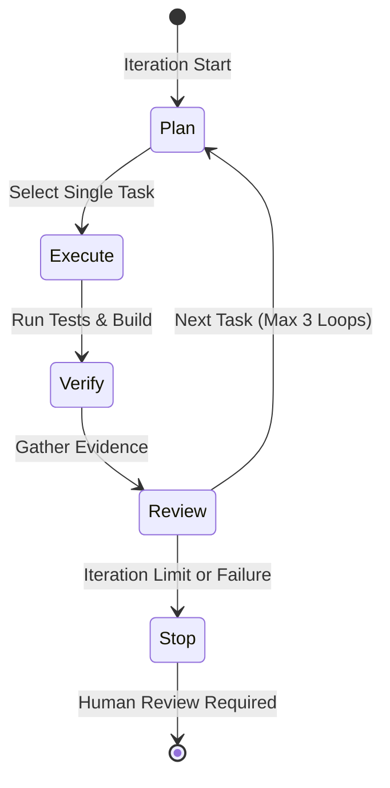

# RALPH AUTONOMOUS DEVELOPMENT LOOP — PRODUCT REQUIREMENTS DOCUMENT (PRD)

**System Reference:** `docs/ralph/PRD.md`  
**Target Repository:** `talentxcel-nexus`  
**Governance Model:** Ralph Iterative Autonomous Loop + Antigravity GSD Integration  
**Framework Status:** Initialized (Setup Phase Only)  
**Creation Date:** November 19, 2026  
**Execution Authority:** Controlled Human-in-the-Loop Autonomous Engineering  

---

## 1. PURPOSE & OBJECTIVES

The **Ralph Autonomous Development Loop** provides a persistent, disciplined, self-correcting development framework tailored for `talentxcel-nexus`. Its primary mission is to systematically execute codebase enhancements, technical SEO implementations, content engine components, and revenue operations tooling without incurring uncontrolled drift, regressions, or unauthorized production deployments.

### Core Objectives:
1. **Iterative Rigor:** Deconstruct complex epics into discrete, verifiable tasks executed one at a time.
2. **Empirical Verification:** Enforce mandatory automated and manual verification before any task is marked complete.
3. **Persistent Memory:** Maintain an auditable trail of decisions, progress, errors, and verifications in repository documentation.
4. **Strict Containment:** Never modify production infrastructure, push commits, or bypass human review without explicit authorization.

---

## 2. GOVERNANCE & OPERATING RULES

Every Ralph autonomous agent cycle must strictly adhere to the following ten inviolable rules:

| # | Operating Rule | Strict Operational Constraint |
| :--- | :--- | :--- |
| **1** | **Read Prior Context** | Must inspect existing codebase maps, ADRs, and verification logs before initiating work. |
| **2** | **Protect GSD State** | Never overwrite existing documentation, system reports, or audit ledgers without explicit versioning. |
| **3** | **Persistent Record** | Every task must be recorded with unique IDs in `TASKS.md` and tracked in `PROGRESS.md`. |
| **4** | **Single-Task Focus** | Work on exactly **one task at a time**. Never bundle multiple features into a single cycle. |
| **5** | **Pre-Completion Proof** | A task cannot be marked completed without empirical verification evidence documented in `VERIFICATION.md`. |
| **6** | **Transparent Error Logging**| Record all failed attempts, syntax errors, build failures, and unexpected behaviors in `PROGRESS.md`. |
| **7** | **Zero Assumed Passes** | Never claim a test passed without actual execution evidence (exit code 0, command output, test assertion count). |
| **8** | **Strict Iteration Limit** | **Stop automatically after three iterations**. Present findings and await human input. |
| **9** | **Human Git Gate** | Require explicit human approval before staging or committing changes to Git. |
| **10**| **No Direct Production Ops**| Never deploy to production, alter DNS/Vercel settings, or modify live infrastructure autonomously. |

---

## 3. RALPH ITERATION PROTOCOL

Each iteration in the loop follows a strict four-stage state machine:

### Stage Specifications:
1. **Plan Stage:**
   - Select the highest-priority pending task from `docs/ralph/TASKS.md`.
   - Confirm dependencies, preconditions, and verification criteria.
   - Record task selection in `docs/ralph/PROGRESS.md`.
2. **Execute Stage:**
   - Make minimal, surgical modifications to code or documentation.
   - Do not touch unrelated files or refactor outside task scope.
3. **Verify Stage:**
   - Execute applicable automated checks (`npm run build`, `npm run lint`, unit/integration tests).
   - If tests fail, log error in `PROGRESS.md` and attempt self-correction within iteration budget.
4. **Review & Gate Stage:**
   - Document pass/fail status and output snippets in `docs/ralph/VERIFICATION.md`.
   - Update task status in `docs/ralph/TASKS.md`.
   - Check iteration count: If iteration count reaches **3**, pause and request human guidance.

---

## 4. SYSTEM SCOPE & SYSTEM BOUNDARIES

### In-Scope:
- Implementation of approved technical SEO components and schema markup.
- Refinement of enterprise commercial landing pages and lead forms.
- Construction of research report layout templates and data display components.
- Automated testing suite expansion and integration verification.

### Out-of-Scope (Strictly Prohibited):
- Modifying production Vercel project configurations or DNS records.
- Creating mass programmatically generated thin content.
- Pushing to remote repositories or altering Git branches without approval.
- Exposing internal operator desks or administrative endpoints in public builds.
