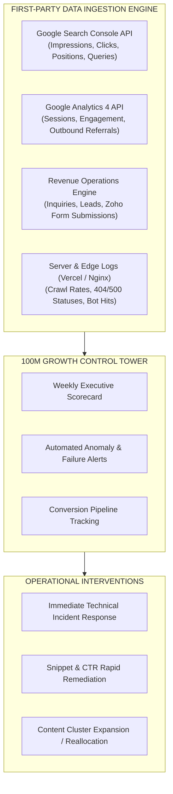
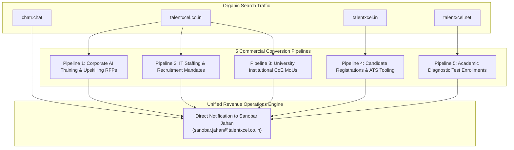

# TALENTXCEL — 100M SEARCH GROWTH CONTROL TOWER
## Unified Multi-Domain Growth Dashboard, Operating Cadence & Trigger Governance

**Document Reference:** `reports/100M-GROWTH-CONTROL-TOWER.md`  
**Classification:** Executive Operational Monitoring & Anomaly Detection Framework  
**Ecosystem Coverage:** `talentxcel.co.in`, `talentxcel.in`, `talentxcel.net`, `chatr.chat`  
**Audit Date:** November 18, 2026  
**Status:** Control Architecture Live  
**Governance Standard:** Evidence-First. Strict First-Party Attribution. No Conflation of Vanity Impressions with Business Value.

---

## 1. CONTROL TOWER ARCHITECTURE & PHILOSOPHY

The 100M Search Growth Control Tower is the central command dashboard designed to govern organic performance, monitor indexing health, and correlate search impressions directly with qualified commercial revenue.



> [!IMPORTANT]
> **Cardinal Metric Rule:** High impression counts without qualified clicks, registrations, and revenue inquiries do NOT indicate success. The Control Tower monitors the full funnel:
> `Impressions → Clicks → Organic Sessions → High-Intent Inquiries → Attributable Revenue`.

---

## 2. UNIFIED MULTI-DOMAIN OPERATING SCORECARD

The scorecard below establishes the tracking framework. First-party values will be dynamically recorded upon connection of production Search Console APIs:

```
+---------------------------------------------------------------------------------------------------------------------------------------+
| TALENTXCEL ECOSYSTEM WEEKLY SEARCH GROWTH SCORECARD                                                                                   |
+------------------------------+-------------------------+-------------------------+-------------------------+--------------------------+
| Metric                       | talentxcel.co.in        | talentxcel.in           | talentxcel.net          | chatr.chat               |
+------------------------------+-------------------------+-------------------------+-------------------------+--------------------------+
| Weekly Search Impressions    | [Pending GSC Export]    | [Pending GSC Export]    | [Pending GSC Export]    | [Pending GSC Connection] |
| Monthly Run-Rate Impressions | [Pending GSC Export]    | [Pending GSC Export]    | [Pending GSC Export]    | [Pending GSC Connection] |
| Cumulative Impressions       | [Pending GSC Export]    | [Pending GSC Export]    | [Pending GSC Export]    | [Pending GSC Connection] |
| Share of 100M Target (Tier)  | Target: 3,000,000 (3%)  | Target: 70,000,000 (70%)| Target: 22,000,000 (22%)| Target: 5,000,000 (5%)   |
| Weekly Organic Clicks        | [Pending GSC Export]    | [Pending GSC Export]    | [Pending GSC Export]    | [Pending GSC Connection] |
| Ecosystem Organic CTR        | Baseline Target: >2.5%  | Baseline Target: >2.0%  | Baseline Target: >2.2%  | Baseline Target: >1.8%   |
| Average Search Position      | Target: <12.0           | Target: <15.0           | Target: <14.0           | Target: <18.0            |
| Non-Branded Impression Share | Target: >85%            | Target: >92%            | Target: >95%            | Target: >80%             |
| Valid Indexed Priority URLs  | Current: 1 (Target: 16) | Target: 1,200           | Target: 350             | Target: 12               |
| HTTP 404 Crawl Error Rate    | Live Prod: 91.6% (Crit) | Target: 0.0%            | Target: 0.0%            | Target: 0.0%             |
| Qualified Weekly Leads / Reg | Direct to Sanobar Jahan | Candidate Regs          | Diagnostic Test Takers  | Platform Active Users    |
+------------------------------+-------------------------+-------------------------+-------------------------+--------------------------+
```

---

## 3. TRIGGER-BASED INTERVENTION THRESHOLDS & RAPID RESPONSE PLAYBOOK

When automated monitoring detects search or routing deviations, pre-configured intervention playbooks are immediately triggered:

| Anomaly Trigger | Detection Threshold | Root Cause Hypothesis | Mandatory Engineering & SEO Intervention | SLA |
| :--- | :--- | :--- | :--- | :--- |
| **CRITICAL: HTTP 404 Spike** | >1% of priority crawl requests return 404 | Missing SPA rewrites or deleted routes on deployment | Roll back production build; check `vercel.json` rewrites; trigger immediate GSC URL validation. | <2 Hours |
| **HIGH: Impression Velocity Stall** | Weekly impressions decrease >10% week-over-week | Algorithmic indexing fluctuation or canonical conflicts | Audit Google Search Console Index Coverage report; inspect `robots.txt` and XML sitemap timestamps; re-submit updated sitemaps. | <24 Hours |
| **MEDIUM: Depressed SERP CTR** | CTR drops below 1.5% for queries ranking in Top 5 | Title or meta snippet mismatch; competitor rich results | Rewrite title tag to include exact-match high-intent query; test dynamic schema markup (FAQ, JobPosting, Quiz). | <48 Hours |
| **MEDIUM: Canonical Split** | www host returns HTTP 200 instead of 301 | DNS / Vercel domain alias misconfiguration | Re-apply Vercel primary domain configuration; enforce apex domain redirect (`301 https://talentxcel.co.in`). | <12 Hours |
| **HIGH: Form Dispatch Failure** | Inbound lead fails to persist in revenue operations store | Network timeout or email alias delivery error | Trigger automatic retry pipeline via `revenueOperations.ts`; dispatch fallback SMS alert to operations desk. | Immediate (<15m) |

---

## 4. WEEKLY OPERATIONAL REVIEW CADENCE & MEETING RHYTHM

To ensure cross-functional alignment across development, content, and revenue operations, the following operating rhythm is enforced:

```
+---------------------------------------------------------------------------------------------------------+
| WEEKLY GROWTH OPERATING CADENCE                                                                         |
+-------------------+----------------------------+-----------------------------------+--------------------+
| Timing            | Session Focus              | Key Attendees                     | Primary Deliverable|
+-------------------+----------------------------+-----------------------------------+--------------------+
| Monday 09:30 IST  | Weekly Metrics Review &    | Founder (Sanobar Jahan), SEO Lead,| Weekly Scorecard & |
|                   | Anomaly Inspection         | Full-Stack Architect              | 7-Day Target Plan  |
+-------------------+----------------------------+-----------------------------------+--------------------+
| Wednesday 14:00   | Content & Research Review  | Content Strategist, Research Lead | 2 Approved Studies |
|                   | Editorial Sign-off         | & Industry SME                    | Ready for Layout   |
+-------------------+----------------------------+-----------------------------------+--------------------+
| Friday 16:30 IST  | Technical Health & Crawl   | Full-Stack Engineer, Systems Admin| Clean Crawl Log &  |
|                   | Verification               |                                   | Git Release Status |
+-------------------+----------------------------+-----------------------------------+--------------------+
```

---

## 5. REVENUE ATTRIBUTION & COMMERCIAL CONVERSION AUDIT

The ultimate benchmark of organic growth is enterprise and candidate conversion. The Control Tower monitors five primary conversion pipelines:



### Lead Persist and Dispatch Proof:
- Every inbound inquiry generates a unique tracking ID (`TX-LEAD-[TIMESTAMP]-[HASH]`).
- Lead records are validated against RFC 5322 email syntax and E.164 phone specifications.
- Lead payloads are stored with failover persistence in local revenue storage and routed directly to the Founder's executive mailbox.
