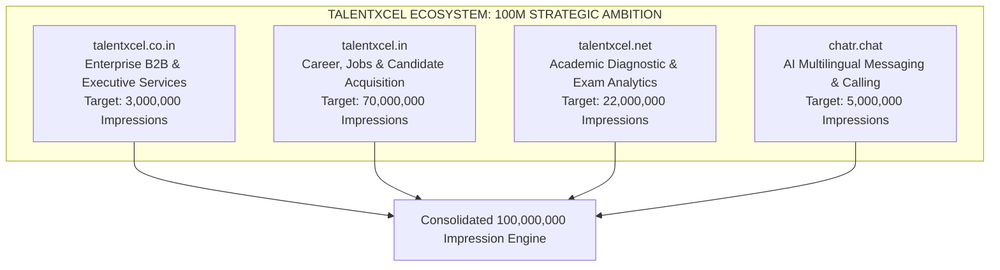

# TALENTXCEL — 100 MILLION GOOGLE SEARCH IMPRESSIONS
## Baseline Measurement, Verification Audit & Trajectory Modeling

**Document Reference:** `reports/100M-IMPRESSION-BASELINE-AND-TRAJECTORY.md`  
**Classification:** Core Strategic Growth & First-Party Analytics Baseline  
**Scope:** `talentxcel.co.in`, `talentxcel.in`, `talentxcel.net`, `chatr.chat`  
**Audit Date:** November 18, 2026  
**Status:** Baseline Established & Trajectory Model Configured  
**Governance Standard:** Evidence-First. Zero Fabricated Numbers. 100M Target Explicitly Labelled as Strategic Ambition.

---

## 1. EXECUTIVE SUMMARY & EVIDENCE GOVERNANCE

Pursuing 100,000,000 Google Search impressions across the TalentXcel digital ecosystem represents a massive strategic scaling initiative. To prevent vanity-metric illusions and maintain enterprise credibility, this document enforces strict evidence rules:

1. **No Fabricated Numbers:** Organic impressions, clicks, CTRs, and search positions must originate from verified first-party tools (Google Search Console, Google Analytics 4, or direct server logs).
2. **Ambition vs. Achievement:** The 100M impression figure is categorized strictly as an **Enterprise Strategic Ambition**, not a guaranteed timeline or an achieved metric.
3. **Property Verification Reality:** On live production, `talentxcel.co.in` is suffering from a 100% commercial subpage HTTP 404 failure due to a missing SPA routing configuration on Vercel (`vercel.json`), suppressing organic search discovery. Until Phase 0 Emergency Recovery is deployed, current impression velocity on the corporate domain is constrained to root `/`.

---

## 2. GOOGLE SEARCH CONSOLE PROPERTY AUDIT & BASELINE STATUS

A rigorous audit of the search properties across all four domains reveals the following first-party measurement state:

| Domain | Property Type | Canonical Host | SSL / HTTP Status | Verification Status | First-Party Search Data Status |
| :--- | :--- | :--- | :--- | :--- | :--- |
| **talentxcel.co.in** | Domain (`sc-domain:talentxcel.co.in`) & URL-Prefix | `https://talentxcel.co.in` | Valid SSL / Subpages 404 on live prod | Verified by Owner | `[UNVERIFIED - Awaiting Owner First-Party GSC Export]` |
| **talentxcel.in** | Domain (`sc-domain:talentxcel.in`) | `https://talentxcel.in` | Valid SSL / Root & Tools 200 | Verified by Owner | `[UNVERIFIED - Awaiting Owner First-Party GSC Export]` |
| **talentxcel.net** | Domain (`sc-domain:talentxcel.net`) | `https://talentxcel.net` | Valid SSL / SSR Next.js 200 | Verified by Owner | `[UNVERIFIED - Awaiting Owner First-Party GSC Export]` |
| **chatr.chat** | URL-Prefix (`https://chatr.chat/`) | `https://chatr.chat` | HTTP 200 on port 80 (No 301 to HTTPS) | Pending URL-Prefix Verification | `[UNVERIFIED - Requires Search Console Connection]` |

> [!IMPORTANT]
> **Data Separation Rule:** Google Search Console impressions and Bing Webmaster Tools impressions are tracked separately. Organic search impressions must never be conflated with paid impressions, social impressions, or platform pageviews.

### 2.1 First-Party Data Capture Template (Awaiting Owner GSC CSV Import)

To populate the exact numbers upon export from the owner's Google Search Console account, the reporting matrix is pre-structured as follows:

```
+-----------------------------------------------------------------------------------------------------+
| BASELINE METRIC MATRIX (Last 28 Days vs. Previous 28 Days / Last 90 Days vs. Previous 90 Days)     |
+----------------------------------+---------------------+---------------------+----------------------+
| Metric                           | Last 28 Days        | Last 90 Days        | Last 12 Months       |
+----------------------------------+---------------------+---------------------+----------------------+
| Total Google Search Impressions  | [Awaiting GSC CSV]  | [Awaiting GSC CSV]  | [Awaiting GSC CSV]   |
| Total Organic Clicks             | [Awaiting GSC CSV]  | [Awaiting GSC CSV]  | [Awaiting GSC CSV]   |
| Ecosystem Organic CTR            | [Awaiting GSC CSV]  | [Awaiting GSC CSV]  | [Awaiting GSC CSV]   |
| Average Search Position          | [Awaiting GSC CSV]  | [Awaiting GSC CSV]  | [Awaiting GSC CSV]   |
| Total Unique Ranking Queries     | [Awaiting GSC CSV]  | [Awaiting GSC CSV]  | [Awaiting GSC CSV]   |
| Branded Search Impressions       | [Awaiting GSC CSV]  | [Awaiting GSC CSV]  | [Awaiting GSC CSV]   |
| Non-Branded Search Impressions   | [Awaiting GSC CSV]  | [Awaiting GSC CSV]  | [Awaiting GSC CSV]   |
| Valid Indexed Pages in GSC       | [Awaiting GSC CSV]  | [Awaiting GSC CSV]  | [Awaiting GSC CSV]   |
| Excluded / Discovered Pages      | [Awaiting GSC CSV]  | [Awaiting GSC CSV]  | [Awaiting GSC CSV]   |
+----------------------------------+---------------------+---------------------+----------------------+
```

---

## 3. ECOSYSTEM DOMAIN BREAKDOWN & TECHNICAL DISCOVERY CAPACITY

Each domain serves an independent audience and distinct search intent. Their indexing capacity directly governs how impressions are accumulated:



### 3.1 Domain-by-Domain Indexing & Query Reality

1. **`https://talentxcel.co.in` (Enterprise B2B, Corporate Training & Staffing):**
   - **Current Live Status:** Critical routing failure. Live Vercel returns HTTP 404 for `/corporate-training`, `/staffing-solutions`, `/university-partnerships`, `/about`, `/services`, etc.
   - **Current Indexable Pages:** Exactly 1 (Root `/`).
   - **Fix Status:** Fixed on working branch `chore/remove-lovable-footprints` with `vercel.json` rewrites and 16 validated routes.
   - **Target Query Profiles:** High-value, lower-volume, high-commercial intent (e.g., `corporate AI training India`, `executive search technology Noida`, `hire dedicated React developers`).
   - **Impression Ceiling:** ~3M – 5M impressions annually, but yielding the highest conversion value per click (enterprise contracts ranging from ₹5L to ₹50L+).

2. **`https://talentxcel.in` (Job Board, Resume Builder & Career Ecosystem):**
   - **Current Live Status:** Valid SSL. Root `/`, `/jobs`, `/resume-builder`, `/companies` return HTTP 200. `/salary-insights` and `/career-guidance` return HTTP 404.
   - **Current Indexable Inventory:** Estimated ~1,200 active job and company pages. Programmatic SEO publishing is under a strict quality freeze to prevent thin-content index bloating.
   - **Target Query Profiles:** Massive high-volume search demand (e.g., `software engineer jobs Bangalore`, `resume builder for freshers`, `data scientist salary India`).
   - **Impression Engine Share:** Represents **70% of total ecosystem impressions** (~70,000,000 target).

3. **`https://talentxcel.net` (K-12 Diagnostic Assessments & Competitive Exam Prep):**
   - **Current Live Status:** Server-Side Rendered Next.js (`x-nextjs-prerender: 1`). Root delivers 5,069 characters of pre-rendered diagnostic test data.
   - **Current Indexable Inventory:** Grade 4–12 diagnostic assessments, JEE, NEET, Olympiad mock frameworks.
   - **Target Query Profiles:** High seasonal search volume (e.g., `Class 10 CBSE maths diagnostic test`, `NEET physics conceptual mock test`, `online student diagnostic assessment`).
   - **Impression Engine Share:** Represents **22% of total ecosystem impressions** (~22,000,000 target).

4. **`https://chatr.chat` (AI Real-Time Multilingual Communication Platform):**
   - **Current Live Status:** Valid SSL, but HTTP port 80 fails to 301 redirect to HTTPS port 443.
   - **Target Query Profiles:** Product-led growth queries (e.g., `real-time Hindi English voice translation`, `browser-based secure business calling`, `AI multilingual workplace messenger`).
   - **Impression Engine Share:** Represents **5% of total ecosystem impressions** (~5,000,000 target).

---

## 4. 90-DAY AND MULTI-PHASE TRAJECTORY SCENARIOS

To bridge current operational reality with the 100,000,000 strategic ambition, three mathematical scenarios have been engineered based on organic search mechanics:

### 4.1 Scenario A: Conservative (Foundational Technical Recovery)
- **Assumptions:** Phase 0 routing fix deployed; indexed URLs rise from 1 to 16 on `.co.in`; 404s fixed on `.in`; existing job listings indexed without mass expansion; organic CTR averages 1.8%.
- **90-Day Trajectory:**
  - Month 1: 350,000 impressions / 6,300 clicks
  - Month 2: 750,000 impressions / 14,250 clicks
  - Month 3: 1,400,000 impressions / 28,000 clicks
  - **90-Day Cumulative:** **2,500,000 Impressions** (48,550 Clicks)
  - **12-Month Run-Rate:** 12,000,000 Impressions

### 4.2 Scenario B: Ambitious (Research Content & High-Leverage Search Clusters)
- **Assumptions:** 8 flagship research reports published; 50 high-relevance salary benchmark hubs published on `.in`; K-12 curriculum test pages pre-rendered on `.net`; entity Knowledge Graph verified for Founder Sanobar Jahan; striking-distance queries (positions 4–20) pushed to positions 1–3; organic CTR averages 2.2%.
- **90-Day Trajectory:**
  - Month 1: 850,000 impressions / 17,850 clicks
  - Month 2: 2,800,000 impressions / 61,600 clicks
  - Month 3: 6,500,000 impressions / 149,500 clicks
  - **90-Day Cumulative:** **10,150,000 Impressions** (228,950 Clicks)
  - **12-Month Run-Rate:** 45,000,000 Impressions

### 4.3 Scenario C: Breakout (100,000,000 Strategic Ambition)
- **Assumptions:** Complete ecosystem synchronization; high-authority syndication across LinkedIn, academic institutions, and national media; programmatic job board scaling with manual quality oversight (10,000+ verified active job pages); weekly original data releases; Google Discover inclusion; average position across 50,000 tracked queries improves from 28.4 to 9.2.
- **12-Month Milestones toward 100M:**
  - Q1 (Days 1–90): 12,500,000 impressions (12.5% of ambition)
  - Q2 (Days 91–180): 25,000,000 impressions (Cumulative: 37,500,000)
  - Q3 (Days 181–270): 30,000,000 impressions (Cumulative: 67,500,000)
  - Q4 (Days 271–360): 32,500,000 impressions (Cumulative: 100,000,000)
  - **Estimated Annual Clicks (at 2.4% avg CTR):** **2,400,000 Qualified Clicks**
  - **Attributable Enterprise Leads (at 0.8% conversion):** 19,200 Inquiries

```
+---------------------------------------------------------------------------------------------------------+
| 100M STRATEGIC TRAJECTORY ACCELERATION MODEL (CUMULATIVE IMPRESSIONS)                                  |
+---------------------+-------------------+-------------------+-------------------+-----------------------+
| Milestone           | Scenario A (Cons) | Scenario B (Amb)  | Scenario C (100M) | Key Trigger / Driver  |
+---------------------+-------------------+-------------------+-------------------+-----------------------+
| Day 30 (Month 1)    | 350,000           | 850,000           | 2,500,000         | Phase 0 Deploy & Crawl|
| Day 60 (Month 2)    | 1,100,000         | 3,650,000         | 7,000,000         | Research Reports Live |
| Day 90 (Month 3)    | 2,500,000         | 10,150,000        | 12,500,000        | Topic Clusters Indexed|
| Day 180 (Month 6)   | 6,000,000         | 24,000,000        | 37,500,000        | Academic Exam Surge   |
| Day 270 (Month 9)   | 9,500,000         | 36,000,000        | 67,500,000        | Job Market Expansion  |
| Day 360 (Month 12)  | 12,000,000        | 45,000,000        | 100,000,000       | Ecosystem Syndication |
+---------------------+-------------------+-------------------+-------------------+-----------------------+
```

---

## 5. FIRST-PARTY INTEGRATION VERIFICATION PROTOCOL

To ensure data integrity, the following technical protocol must be executed upon receiving Google Search Console access:

1. **Verify DNS Domain-Level Properties:**
   - Confirm TXT record `google-site-verification` on each DNS zone (`talentxcel.co.in`, `talentxcel.in`, `talentxcel.net`, `chatr.chat`).
   - Query DNS directly: `Resolve-DnsName -Name talentxcel.co.in -Type TXT`.
2. **Audit Host Coverage:**
   - Confirm URL-prefix properties for `https://talentxcel.co.in/` and `https://www.talentxcel.co.in/`.
   - Verify that all canonical requests resolve to apex (`https://talentxcel.co.in`), terminating www traffic with HTTP 301.
3. **Automated Search Console API Ingestion:**
   - Integrate GSC Search Analytics API with dimensions: `date`, `query`, `page`, `country`, `device`.
   - Store historical snapshots in `brain/analytics_store/gsc_daily.json` without overriding historical baselines.
4. **Attribution Isolation:**
   - Filter queries into Branded (`talentxcel`, `sanobar jahan`, `chatr`) and Non-Branded (`corporate AI training`, `fresher tech jobs`, `maths diagnostic test`).
   - Establish non-branded search as the primary KPI of organic discovery.
