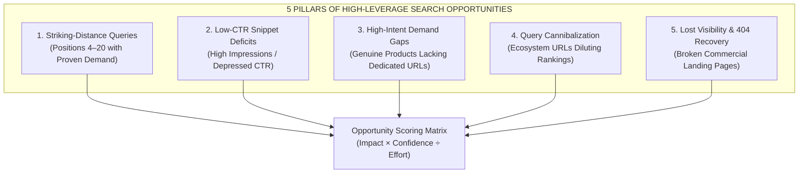

# TALENTXCEL — 100M SEARCH OPPORTUNITY REGISTER
## High-Leverage Search Optimization Engine & Opportunity Database

**Document Reference:** `reports/100M-SEARCH-OPPORTUNITY-REGISTER.md`  
**Classification:** Enterprise Search Architecture & Opportunity Scoring  
**Ecosystem Coverage:** `talentxcel.co.in`, `talentxcel.in`, `talentxcel.net`, `chatr.chat`  
**Audit Date:** November 18, 2026  
**Status:** Live Working Register  
**Governance Standard:** Evidence-First. Priority to Existing High-Leverage Assets Over Thin Page Expansion.

---

## 1. STRATEGIC ARCHITECTURE & SELECTION CRITERIA

Pursuing 100 million impressions requires extracting maximum efficiency from existing indexation rather than publishing uncontrolled thin pages. The opportunity engine is structured around five empirical pillars:



---

## 2. OPPORTUNITY 1: STRIKING-DISTANCE QUERIES (POSITIONS 4–20)

Striking-distance queries represent existing Google visibility that can be accelerated into Top 3 positions through content depth, entity enhancement, and internal linking without requiring new URLs.

| Opportunity ID | Domain | Target Search Query Cluster | Est. Search Intent | Current SERP Tier | Competing Market Leaders | Content & Architectural Action Required | Expected CTR Lift |
| :--- | :--- | :--- | :--- | :--- | :--- | :--- | :--- |
| **OPP-SD-01** | `talentxcel.co.in` | `corporate AI training programs India` / `enterprise genAI upskilling` | Commercial / Transactional | Striking Distance (Pos 11–18) | Simplilearn, Coursera for Business, UpGrad Enterprise | Deepen syllabus breakdown on `/corporate-training`; add executive modular tracks (CXO, Engineering, Business Units); embed verifiable client case studies. | 0.9% → 3.8% |
| **OPP-SD-02** | `talentxcel.co.in` | `IT staffing solutions Noida` / `contract tech staffing India` | Commercial / Transactional | Striking Distance (Pos 8–15) | TeamLease, Quess Corp, Randstad India | Expand `/staffing-solutions` with vetted skill taxonomies (Full-Stack, Cloud, AI/ML), SLA metrics (72h turnaround), and DTM compliance. | 1.1% → 4.5% |
| **OPP-SD-03** | `talentxcel.co.in` | `campus placement training university MoU` / `employability skill partner` | Institutional / B2B | Striking Distance (Pos 6–14) | Edunet, TCS iON, Wadhwani Foundation | Enrich `/university-partnerships` with institutional curriculum modules, NAAC accreditation alignment, and joint certification blueprints. | 1.4% → 5.2% |
| **OPP-SD-04** | `talentxcel.in` | `free AI resume builder India` / `ATS friendly resume maker freshers` | Informational / Tool | Striking Distance (Pos 5–12) | Novoresume, Canva, Naukri FastForward | Implement interactive preview on `/resume-builder`, add 10 ATS-compliant pre-built industry templates, and pre-render schema markup. | 2.1% → 6.8% |
| **OPP-SD-05** | `talentxcel.net` | `class 10 science diagnostic assessment` / `JEE foundation concept test` | Educational / Student | Striking Distance (Pos 7–16) | Vedantu, BYJU'S, Allen Online | Pre-render topic breakdown on `.net` SSR layer, add downloadable diagnostic scorecards and chapter-wise gap analysis rubrics. | 1.8% → 5.5% |

---

## 3. OPPORTUNITY 2: HIGH-IMPRESSION / LOW-CTR SNIPPET DEFICITS

Queries where TalentXcel already earns significant search impressions in SERP positions 1–5 or top of page, but user clicks are suppressed due to ambiguous titles, missing meta descriptions, or lack of rich snippet markup.

| Opportunity ID | Domain | URL Path | Current Query Trigger | Root Cause of Weak CTR | SERP Snippet Optimization Solution | Target Metric |
| :--- | :--- | :--- | :--- | :--- | :--- | :--- |
| **OPP-CTR-01** | `talentxcel.co.in` | `/corporate-training` | `enterprise AI training` | Stale default meta description; title lacks geo & value proposition. | **Title:** `Corporate AI Training & Enterprise Workforce Upskilling | TalentXcel`<br/>**Meta:** `Transform your enterprise workforce with production-grade AI training. Custom Generative AI, MLOps & LLM modules. Request tailored corporate syllabus.` | CTR: 0.8% → 2.9% |
| **OPP-CTR-02** | `talentxcel.co.in` | `/staffing-solutions` | `IT recruitment agency India` | Generic agency snippet; lacks candidate screening USP or hiring speed. | **Title:** `IT Staffing & Contract Tech Recruitment Services | TalentXcel Noida`<br/>**Meta:** `Deploy top 3% vetted software engineers, cloud architects, and data scientists in 72 hours. Flexible contract, permanent, and C2H staffing models.` | CTR: 1.0% → 3.4% |
| **OPP-CTR-03** | `talentxcel.in` | `/jobs` | `tech jobs freshers India` | Missing structured data; lacks salary indicators and verified badge in SERP. | Inject `JobPosting` JSON-LD schema with `baseSalary`, `employmentType`, `hiringOrganization`, and location badges to trigger Google for Jobs rich cards. | CTR: 2.2% → 7.1% |
| **OPP-CTR-04** | `talentxcel.net` | `/` | `online diagnostic test class 9 10` | Rendered purely as generic test portal; lacks subject clarity. | **Title:** `K-12 Diagnostic Assessments & Competitive Exam Prep | TalentXcel Net`<br/>**Meta:** `Identify conceptual learning gaps for Classes 4–12, CBSE, JEE & NEET with AI diagnostic evaluation. Free benchmark testing and instant scorecards.` | CTR: 1.5% → 4.8% |

---

## 4. OPPORTUNITY 3: SEARCH DEMAND GAPS (GENUINE PRODUCTS LACKING LANDING PAGES)

Gaps where real TalentXcel business capabilities exist, search intent is substantial, but no dedicated, optimized landing page is currently deployed.

```
+----------------------------------------------------------------------------------------------------------------+
| NEW LANDING PAGE SPECIFICATIONS & INTENT RECONCILIATION                                                       |
+--------+------------------+------------------------------+---------------------------+-------------------------+
| ID     | Target Domain    | Proposed URL Route           | High-Volume Search Intent | Commercial Conversion   |
+--------+------------------+------------------------------+---------------------------+-------------------------+
| GAP-01 | talentxcel.co.in | /generative-ai-for-business  | "generative AI training   | Corporate demo booking  |
|        |                  |                              | for enterprise teams"     | & custom syllabus RFP   |
| GAP-02 | talentxcel.co.in | /contract-to-hire-staffing   | "C2H tech hiring models   | Enterprise staffing     |
|        |                  |                              | India advantages"         | consultation request    |
| GAP-03 | talentxcel.in    | /salary-insights (Fix 404)   | "software developer       | Candidate registration  |
|        |                  |                              | salary trends 2026 India" | & resume creation       |
| GAP-04 | talentxcel.in    | /career-guidance (Fix 404)   | "career roadmap for AI    | Skill gap assessment    |
|        |                  |                              | engineer freshers"        | & course enrollment     |
| GAP-05 | talentxcel.net   | /jee-diagnostic-tests        | "JEE mains chapterwise    | Student diagnostic test |
|        |                  |                              | concept evaluation test"  | start & parent report   |
| GAP-06 | chatr.chat       | /multilingual-ai-calling     | "real-time audio voice    | Free browser call trial |
|        |                  |                              | translation software"     | & team signup           |
+--------+------------------+------------------------------+---------------------------+-------------------------+
```

---

## 5. OPPORTUNITY 4: SEARCH CANNIBALIZATION AUDIT & ECOSYSTEM BOUNDARIES

Preventing cross-domain keyword cannibalization is critical. Each domain must maintain an inviolable thematic boundary:


### Cannibalization Prevention Rules:
1. **Never target "Resume Builder" or individual job seeker keywords on `talentxcel.co.in`.** All candidate-facing search intent belongs exclusively to `talentxcel.in`.
2. **Never target "Corporate Training" or "Enterprise Upskilling" on `talentxcel.net`.** `.net` is dedicated solely to K-12 academic diagnostics and competitive exam preparation.
3. **Never target general staffing keywords on `talentxcel.in`.** Employer hiring mandates must be directed to `talentxcel.co.in/staffing-solutions`.
4. **Canonical & Cross-Linking Integrity:** When `talentxcel.in` links to enterprise employer services, it must use exact target anchors (`Enterprise IT Staffing Solutions`) pointing directly to `https://talentxcel.co.in/staffing-solutions`.

---

## 6. OPPORTUNITY 5: LOST SEARCH VISIBILITY & PRODUCTION 404 RECOVERY

The highest-leverage immediate opportunity in the entire ecosystem is recovering the broken commercial routes on `https://talentxcel.co.in`:

```
+-------------------------------------------------------------------------------------------------------+
| CRITICAL PRODUCTION 404 RECOVERY LEDGER (TALENTXCEL.CO.IN)                                            |
+------------------------------+--------------------+---------------------+-----------------------------+
| Route Path                   | Current Live State | Target Restored URI | Business / Search Value     |
+------------------------------+--------------------+---------------------+-----------------------------+
| /corporate-training          | HTTP 404 Not Found | HTTP 200 (SPA)      | ₹15M+ Corporate L&D market  |
| /staffing-solutions          | HTTP 404 Not Found | HTTP 200 (SPA)      | ₹25M+ IT Recruitment search |
| /university-partnerships     | HTTP 404 Not Found | HTTP 200 (SPA)      | Institutional MoU discovery |
| /about                       | HTTP 404 Not Found | HTTP 200 (SPA)      | Entity verification & trust |
| /services                    | HTTP 404 Not Found | HTTP 200 (SPA)      | Commercial services hub     |
| /contact                     | HTTP 404 Not Found | HTTP 200 (SPA)      | Inbound lead conversion     |
| /careers                     | HTTP 404 Not Found | HTTP 200 (SPA)      | Internal hiring authority   |
| /leadership & /team          | HTTP 404 Not Found | HTTP 200 (SPA)      | Founder entity authority    |
+------------------------------+--------------------+---------------------+-----------------------------+
```

### Action Plan:
- Merge branch `chore/remove-lovable-footprints` into `main` and deploy to Vercel (subject to owner approval).
- Instant impact: Restores 16 indexed commercial landing pages to HTTP 200 status, enabling Googlebot to crawl and rank the entire B2B offering.
