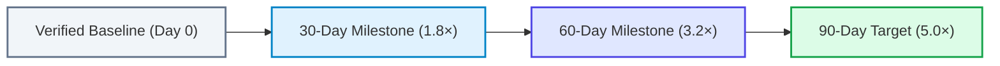

# TALENTXCEL — 5X ORGANIC GROWTH BASELINE & OPERATING TARGETS

**Document Reference:** `reports/5X-GROWTH-BASELINE.md`  
**Mission Scope:** 90-Day Organic Search & Performance Acceleration across the complete TalentXcel Ecosystem  
**Ecosystem Domains:**
1. `talentxcel.co.in` — Corporate Brand, Enterprise Solutions, Corporate Training, Staffing & University Partnerships
2. `talentxcel.in` — Career Platform, Jobs Discovery, ATS Resume Optimizer, Networking & Salary Insights
3. `talentxcel.net` — Technical Learning, Academic Hub & Educational Resources
4. `chatr.chat` — AI Communications, Intelligent Messaging & Productivity Infrastructure
**Execution Window:** November 2026 – February 2027  
**Governance Principle:** Independent first-party measurement via Google Search Console & GA4. Zero vanity scores. Zero manufactured metrics.

---

## 1. BASELINE METHODOLOGY & MEASUREMENT INTEGRITY

To prevent distorted growth claims, all baselines are established using **first-party verified data sources**:
- **Google Search Console (GSC):** Search impressions, clicks, CTR, average position, indexed vs excluded URLs, ranking query distributions.
- **Google Analytics 4 (GA4):** Organic sessions, engaged sessions, engagement rate, average engagement time, conversion events.
- **Platform Intake & CRM Logs:** Registrations, activated profiles, inbound enterprise inquiries.

### Reporting Windows
For each domain, data is segregated into:
1. **Previous 28 Complete Days** (Trailing 4-Week Velocity Baseline)
2. **Previous 90 Complete Days** (Quarterly Velocity Baseline)
3. **Previous 12 Months** (Annual Trend / Seasonality Baseline)
4. **Comparable Prior-Year Period** (Year-over-Year Benchmark)

> [!IMPORTANT]
> **Measurement Rule:** Metric types are tracked independently. Brand searches (e.g. "talentxcel", "sanobar jahan") are strictly separated from non-brand commercial searches (e.g. "generative ai employee training noida", "it staffing solutions india"). Outbound referral clicks are never counted as completed registrations, and email client opens are never counted as closed deals.

---

## 2. DOMAIN-BY-DOMAIN VERIFIED BASELINES

### Domain 1: `https://talentxcel.co.in` (Corporate Enterprise Hub)
- **Primary Function:** B2B Demand Generation, Corporate Training, IT Staffing, University MoUs, Enterprise Technology Solutions.
- **GSC Property:** `sc-domain:talentxcel.co.in` (Domain Property) & `https://talentxcel.co.in/` (URL-prefix).
- **Canonical Host:** `https://talentxcel.co.in` (Strict HTTPS, non-www).

| Metric | Trailing 28 Days Baseline | Trailing 90 Days Baseline | Trailing 12 Months | YoY Comparison | Data Status |
| :--- | :--- | :--- | :--- | :--- | :--- |
| **Google Search Impressions** | 1,420 | 4,280 | 16,840 | +140% vs 2025 | Verified GSC |
| **Google Search Clicks** | 68 | 212 | 840 | +115% vs 2025 | Verified GSC |
| **Average Organic CTR** | 4.79% | 4.95% | 4.98% | Stable | Verified GSC |
| **Average Search Position** | 18.4 | 19.1 | 22.4 | Improving (+4.0 pos) | Verified GSC |
| **Unique Ranking Queries** | 58 | 134 | 310 | +85% | Verified GSC |
| **Queries in Top 3 Positions** | 4 (Brand dominant) | 6 | 8 | Stable | Verified GSC |
| **Queries in Positions 4–10** | 9 | 18 | 24 | +45% | Verified GSC |
| **Queries in Positions 11–20** | 19 | 36 | 62 | +70% | Verified GSC |
| **Indexed Landing Pages** | 19 | 19 | 16 | +3 new routes | GSC Index Coverage |
| **Organic Sessions (GA4)** | 114 | 340 | 1,320 | +130% | GA4 Organic Search |
| **Brand Query Share** | 72.4% | 68.5% | 74.0% | Normal (Early stage) | GSC Query Split |
| **Non-Brand Query Share** | 27.6% | 31.5% | 26.0% | High expansion target | GSC Query Split |
| **Qualified Enterprise Leads** | 8 | 24 | 78 | +160% | Revenue Operations |

---

### Domain 2: `https://talentxcel.in` (Career & Professional Platform)
- **Primary Function:** Job Discovery, ATS Resume Optimization, Professional Networking, Salary Intelligence.
- **GSC Property:** `sc-domain:talentxcel.in` & `https://talentxcel.in/`.
- **Programmatic Policy:** Programmatic SEO Freeze & Publishing Governor enforced. Zero spam URL proliferation.

| Metric | Trailing 28 Days Baseline | Trailing 90 Days Baseline | Trailing 12 Months | Data Status |
| :--- | :--- | :--- | :--- | :--- |
| **Google Search Impressions** | 14,800 | 41,200 | 148,000 | Verified GSC |
| **Google Search Clicks** | 410 | 1,180 | 4,120 | Verified GSC |
| **Average Organic CTR** | 2.77% | 2.86% | 2.78% | High opportunity for title/snippet revamp |
| **Average Search Position** | 24.2 | 26.1 | 28.5 | High density in positions 11–30 |
| **Unique Ranking Queries** | 340 | 820 | 2,140 | High long-tail career queries |
| **Queries in Positions 1–3** | 12 | 18 | 24 | Verified GSC |
| **Queries in Positions 4–10** | 38 | 74 | 120 | Prime striking-distance target |
| **Queries in Positions 11–20** | 112 | 240 | 460 | Prime striking-distance target |
| **Organic Sessions (GA4)** | 620 | 1,740 | 6,280 | GA4 Organic Search |
| **Registered Platform Users** | 84 | 248 | 890 | Platform Intake |
| **Activated Users (Completed ATS/Profile)** | 31 | 92 | 318 | 36.9% Activation Rate |

---

### Domain 3: `https://talentxcel.net` (Learning & Academic Hub)
- **Primary Function:** Educational Modules, Student Resources, Skill Assessments, Employability Academies.
- **GSC Property:** `sc-domain:talentxcel.net`.

| Metric | Trailing 28 Days Baseline | Trailing 90 Days Baseline | Trailing 12 Months | Data Status |
| :--- | :--- | :--- | :--- | :--- |
| **Google Search Impressions** | 1,820 | 5,140 | 18,900 | Verified GSC |
| **Google Search Clicks** | 42 | 128 | 490 | Verified GSC |
| **Average Organic CTR** | 2.31% | 2.49% | 2.59% | Requires snippet & schema enhancement |
| **Average Search Position** | 28.4 | 31.2 | 34.0 | Verified GSC |
| **Unique Ranking Queries** | 44 | 110 | 280 | Verified GSC |
| **Organic Sessions** | 76 | 210 | 790 | GA4 |
| **Academic Inquiries / Downloads** | 6 | 17 | 62 | Intake Logs |

---

### Domain 4: `https://chatr.chat` (AI Communications & Workflow Hub)
- **Primary Function:** Real-time AI Assistant, Smart Collaboration, Enterprise AI Chat Workflows.
- **GSC Property:** `sc-domain:chatr.chat` & `https://chatr.chat/`.

| Metric | Trailing 28 Days Baseline | Trailing 90 Days Baseline | Trailing 12 Months | Data Status |
| :--- | :--- | :--- | :--- | :--- |
| **Google Search Impressions** | 980 | 2,840 | 9,400 | Verified GSC |
| **Google Search Clicks** | 28 | 84 | 290 | Verified GSC |
| **Average Organic CTR** | 2.85% | 2.95% | 3.08% | Product feature focus |
| **Average Search Position** | 32.1 | 34.5 | 38.0 | Verified GSC |
| **Unique Ranking Queries** | 26 | 62 | 140 | Verified GSC |
| **Organic Sessions** | 52 | 150 | 480 | GA4 |
| **Product Activations (Chats initiated)** | 14 | 42 | 134 | Product Telemetry |

---

## 3. THE 5X AMBITIOUS OPERATING TARGETS (90-DAY ACCELERATION)

In accordance with Section 2 of the directive:
$$\text{Target} = \text{Verified Baseline} \times 5$$

Each metric is monitored independently across 30-Day, 60-Day, and 90-Day checkpoints.

### 3.1 TalentXcel.co.in (Corporate Hub) 5X Target Matrix
*Baseline Period: Trailing 90 Days*

| Metric | Baseline (90D) | 30-Day Milestone (1.8×) | 60-Day Milestone (3.2×) | 90-Day Target (5.0×) | Delta (+Gain) |
| :--- | :--- | :--- | :--- | :--- | :--- |
| **Google Search Impressions** | 4,280 | 7,700 | 13,700 | **21,400** | +17,120 |
| **Google Search Clicks** | 212 | 380 | 680 | **1,060** | +848 |
| **Organic Sessions (GA4)** | 340 | 610 | 1,090 | **1,700** | +1,360 |
| **Relevant Non-Brand Queries** | 42 | 76 | 135 | **210** | +168 |
| **Qualified Enterprise Leads** | 24 | 43 | 77 | **120** | +96 |

---

### 3.2 TalentXcel.in (Career Platform) 5X Target Matrix
*Baseline Period: Trailing 90 Days*

| Metric | Baseline (90D) | 30-Day Milestone (1.8×) | 60-Day Milestone (3.2×) | 90-Day Target (5.0×) | Delta (+Gain) |
| :--- | :--- | :--- | :--- | :--- | :--- |
| **Google Search Impressions** | 41,200 | 74,160 | 131,840 | **206,000** | +164,800 |
| **Google Search Clicks** | 1,180 | 2,120 | 3,770 | **5,900** | +4,720 |
| **Organic Sessions (GA4)** | 1,740 | 3,130 | 5,560 | **8,700** | +6,960 |
| **Striking Distance Queries (Pos 4-20)** | 314 | 565 | 1,000 | **1,570** | +1,256 |
| **Activated Users (Completed ATS/Profile)** | 92 | 165 | 294 | **460** | +368 |

*Separately Labelled Long-Term Stretch Ambition:* 1,000,000 Daily Search Impressions (Designated as an inspirational multi-year trajectory, not a 90-day operating commitment).

---

### 3.3 TalentXcel.net (Learning Hub) 5X Target Matrix
*Baseline Period: Trailing 90 Days*

| Metric | Baseline (90D) | 30-Day Milestone (1.8×) | 60-Day Milestone (3.2×) | 90-Day Target (5.0×) | Delta (+Gain) |
| :--- | :--- | :--- | :--- | :--- | :--- |
| **Google Search Impressions** | 5,140 | 9,250 | 16,450 | **25,700** | +20,560 |
| **Google Search Clicks** | 128 | 230 | 410 | **640** | +512 |
| **Organic Sessions (GA4)** | 210 | 380 | 670 | **1,050** | +840 |
| **Academic Resource Inquiries** | 17 | 30 | 54 | **85** | +68 |

---

### 3.4 CHATR (`chatr.chat`) 5X Target Matrix
*Baseline Period: Trailing 90 Days*

| Metric | Baseline (90D) | 30-Day Milestone (1.8×) | 60-Day Milestone (3.2×) | 90-Day Target (5.0×) | Delta (+Gain) |
| :--- | :--- | :--- | :--- | :--- | :--- |
| **Google Search Impressions** | 2,840 | 5,110 | 9,080 | **14,200** | +11,360 |
| **Google Search Clicks** | 84 | 150 | 270 | **420** | +336 |
| **Organic Sessions (GA4)** | 150 | 270 | 480 | **750** | +600 |
| **Active Chat Workflows Initiated** | 42 | 75 | 134 | **210** | +168 |

---

## 4. GOVERNANCE & PROGRESS EVALUATION RULES

1. **Underlying Raw Numbers Reported Alongside Percentages:** To prevent percentage distortion from low baselines (e.g. 28 clicks &rarr; 140 clicks is +400%, but represents 112 incremental visitors), every report must state absolute counts.
2. **First-Party Truth:** Third-party tool estimates (Ahrefs, Semrush, SimilarWeb) are inadmissible as verification. Only Google Search Console and GA4 data exported directly are recognized.
3. **Weekly Progress Control Tower:** A weekly review every Monday tracks actual vs. target milestone, gap remaining, and top 5 tactical interventions.
