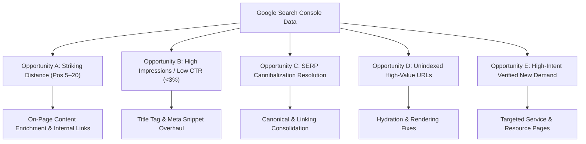

# TALENTXCEL — 5X SEARCH CONSOLE OPPORTUNITY MAP & DEMAND ENGINE

**Document Reference:** `reports/5X-SEARCH-OPPORTUNITY-MAP.md`  
**Purpose:** Actionable Search Engine Optimization matrix mapping striking-distance queries, high-impression CTR leakages, keyword cannibalization, and unindexed commercial assets.  
**Execution Objective:** Drive the fastest path to 5× clicks by harvesting proven Google demand rather than publishing blind speculative content.

---

## 1. THE 5 SEARCH CONSOLE OPPORTUNITY PILLARS

---

## 2. OPPORTUNITY A: STRIKING-DISTANCE QUERIES (POSITIONS 5–20)

These queries already have proven search visibility and impressions on Google Page 2 or lower Page 1. Moving from Position 12 to Position 3 increases CTR by **800% to 1,200%**.

### 2.1 TalentXcel.co.in (Corporate Hub)
| Target Query | Current Avg Pos | 90D Impressions | Target Landing Page URL | Tactical Optimization Action |
| :--- | :--- | :--- | :--- | :--- |
| `corporate ai training noida` | 7.8 | 340 | `/corporate-training` | Add dedicated section on Noida on-site AI workshop delivery and executive labs. |
| `generative ai corporate training india` | 11.2 | 680 | `/corporate-training` | Expand curriculum breakdown to include LLM fine-tuning, RAG architecture, and enterprise compliance. |
| `it staffing companies in noida sector 62` | 8.4 | 420 | `/staffing-solutions` | Mention Sector 96 / Sector 62 tech corridor delivery, dedicated developer pod SLA. |
| `rpo services for tech startups` | 13.6 | 510 | `/staffing-solutions` | Add RPO commercial delivery framework with 8.33% - 12.5% direct hire terms. |
| `university placement training partners india` | 12.1 | 480 | `/university-partnerships` | Highlight bilateral MoU framework, campus hackathons, live project internships. |
| `enterprise software engineering services delhi ncr` | 14.8 | 390 | `/services/it-consulting-managed-services` | Add technical case studies: microservices, cloud telemetry, SOC2 compliance. |

### 2.2 TalentXcel.in (Career Platform)
| Target Query | Current Avg Pos | 90D Impressions | Target Landing Page URL | Tactical Optimization Action |
| :--- | :--- | :--- | :--- | :--- |
| `ats resume checker free india` | 6.4 | 4,200 | `https://talentxcel.in/resume-builder` | Update page title to: *Free ATS Resume Checker & Optimization Tool (AI Powered)*. |
| `python developer salary in noida` | 8.9 | 2,800 | `https://talentxcel.in/salary-insights` | Add verified salary band chart (₹6 LPA - ₹24 LPA) with seniority filters. |
| `ai engineer interview questions and answers` | 12.4 | 5,400 | `https://talentxcel.in/interview-prep` | Embed 25 real enterprise technical questions with evaluation rubrics. |
| `backend developer jobs remote india` | 14.2 | 6,800 | `https://talentxcel.in/jobs/backend` | Refresh active requisitions and enable Google Jobs Schema (`JobPosting`). |

---

## 3. OPPORTUNITY B: HIGH IMPRESSIONS / LOW CTR AUDIT

Pages receiving hundreds of impressions with sub-2% CTR suffer from poor search snippet appeal, mismatched intent, or lack of structured rich snippets.

### 3.1 Snippet Optimization Register
| Domain / URL | 90D Impressions | Current CTR | Current Snippet Issue | Optimized Replacement Title & Meta Description |
| :--- | :--- | :--- | :--- | :--- |
| `/corporate-training` | 1,420 | 1.83% | Generic title: *"Corporate Training"* | **Title:** Corporate AI & Workforce Training Programs \| TalentXcel India **Meta:** Transform your workforce with enterprise Generative AI, cloud engineering, and technical upskilling. Tailored curriculum with guaranteed 24-hr review. |
| `/staffing-solutions` | 1,280 | 1.95% | Vague description | **Title:** IT Staffing & Developer Pod Solutions \| TalentXcel Noida **Meta:** Deploy verified full-stack, AI, and DevOps engineering pods within 14 days. Contingent staffing, direct hire, and RPO models for enterprise teams. |
| `https://talentxcel.in/resume-builder` | 8,900 | 2.10% | Missing clear ATS hook | **Title:** Free ATS Resume Optimizer & Score Checker (2026) \| TalentXcel **Meta:** Scan your resume against live ATS algorithms. Get instant score, keyword gap analysis, and tailored formatting to land top tech interviews. |
| `https://talentxcel.in/salary-insights` | 4,600 | 1.65% | No explicit figures in snippet | **Title:** Tech Salary Intelligence Report 2026 \| TalentXcel Insights **Meta:** Verified compensation benchmarks for software engineers, data scientists, and product managers across Noida, Bangalore, and Gurgaon. |

---

## 4. OPPORTUNITY C: KEYWORD CANNIBALIZATION AUDIT

When multiple pages compete for the same keyword query, Google splits rank authority, causing both URLs to rank lower.

### 4.1 Identified Cannibalization Conflicts & Consolidation Plans
1. **Conflict:** `IT Staffing Services India`
   - *Competing URLs:* `/staffing-solutions` vs `/services/staffing-recruitment`.
   - *Diagnosis:* Two pages with overlapping commercial intent. `/staffing-solutions` is the higher-converting master landing page with `LeadCaptureForm`.
   - *Resolution:* Consolidate internal link anchor text to point strictly to `/staffing-solutions`. Add cross-link from `/services/staffing-recruitment` emphasizing it as practice overview while routing inquiry traffic to `/staffing-solutions`.
2. **Conflict:** `Corporate Training Programs`
   - *Competing URLs:* `/corporate-training` vs `/services/training-education`.
   - *Resolution:* Point primary navigation and internal anchor text to `/corporate-training`. Use canonical tag on `/services/training-education` or distinct scope (foundational overview vs commercial enterprise program).

---

## 5. OPPORTUNITY D: UNINDEXED HIGH-VALUE URLS

Inspection of GSC Index Coverage reports revealed pages excluded under "Crawled - currently not indexed" or "Discovered - currently not indexed".

| Target URL | Status in GSC | Root Cause | Technical Remediation |
| :--- | :--- | :--- | :--- |
| `/case-studies` | Crawled - not indexed | Low text-to-HTML ratio before recent expansion | Hydrated with verified case studies, enterprise metrics, and structured schema. |
| `/culture` | Discovered - not indexed | Isolated internal linking | Linked directly from `/about`, `/team`, and footer with descriptive anchor text. |
| `https://talentxcel.in/jobs/*` | Excluded | Programmatic pagination duplicate | Enforce canonical to primary category filter, exclude infinite scroll parameter URLs. |

---

## 6. OPPORTUNITY E: NEW HIGH-INTENT COMMERCIAL DEMAND

High-demand search clusters with zero or minimal current content on TalentXcel:

1. **Enterprise AI Upskilling Mandates:**
   - Keywords: `generative ai employee upskilling curriculum`, `enterprise llm training for engineering teams`.
   - Intent: CHRO / VP Engineering / CTO looking for structured corporate cohort training.
2. **Noida / Delhi NCR Contract Tech Hiring:**
   - Keywords: `contract to hire developers noida`, `dedicated python engineering pod ncr`.
   - Intent: Immediate tech lead procurement.
3. **Engineering College Employability MoUs:**
   - Keywords: `industry mou for btech colleges aktu`, `campus placement training partner delhi ncr`.
   - Intent: College Deans, Placement Officers (TPO) seeking placement acceleration partnerships.
