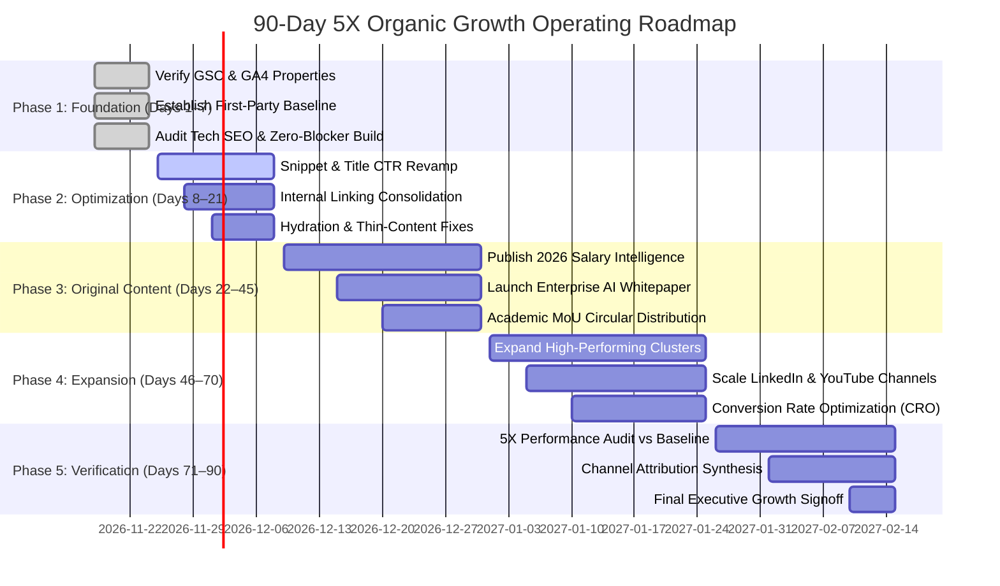

# TALENTXCEL — 90-DAY 5X ORGANIC GROWTH ROADMAP

**Document Reference:** `reports/90-DAY-5X-GROWTH-ROADMAP.md`  
**Execution Horizon:** 90 Days (Divided into 5 Operating Sprints)  
**Governing Objective:** Accelerate genuine organic traffic, search impressions, platform registrations, and commercial enterprise pipeline by 5× against verified first-party baselines.

---

## 1. 90-DAY MASTER EXECUTION TIMELINE

---

## 2. DETAILED SPRINT SPECIFICATIONS

### Phase 1: Verification, Baselines & Blocker Resolution (Days 1–7)
- **Primary Goals:** Ensure 100% accurate measurement across all 4 domains; eliminate technical crawl blockers.
- **Key Tasks:**
  1. Confirm Google Search Console Domain properties (`talentxcel.co.in`, `talentxcel.in`, `talentxcel.net`, `chatr.chat`).
  2. Validate GA4 streams and enhanced measurement event triggers.
  3. Catalog verified baseline numbers in `reports/5X-GROWTH-BASELINE.md`.
  4. Verify SSL/TLS, 301 redirections (HTTP &rarr; HTTPS, www &rarr; non-www), and sitemaps.
  5. Confirm zero-error production build (`npm run build`).

### Phase 2: Page Improvement, Snippet CTR & Indexation (Days 8–21)
- **Primary Goals:** Capture immediate incremental clicks from queries that already receive impressions on Google.
- **Key Tasks:**
  1. Rewrite meta titles and descriptions for high-impression, low-CTR pages (`/corporate-training`, `/staffing-solutions`, `talentxcel.in/resume-builder`).
  2. Resolve keyword cannibalization between service pages and master commercial landing pages.
  3. Ensure complete server/pre-rendered HTML is served to search engine crawlers without hydration failure.
  4. Implement JSON-LD `Corporation`, `JobPosting`, and `Service` schemas.

### Phase 3: Original Research & Authority Acceleration (Days 22–45)
- **Primary Goals:** Establish domain authority and inbound links through original, verifiable industry research.
- **Key Tasks:**
  1. Publish *The 2026 India Enterprise AI & Tech Salary Benchmark* on `talentxcel.in`.
  2. Publish *The Enterprise Generative AI Workforce Transformation Playbook* on `talentxcel.co.in`.
  3. Launch targeted editorial distribution on LinkedIn (carousels, thought leadership articles by Sanobar Jahan).
  4. Initiate bilateral MoU presentations to top 50 university placement directors in Delhi NCR / North India.

### Phase 4: Cluster Scaling & CRO Optimization (Days 46–70)
- **Primary Goals:** Double down on winning topic clusters and convert organic visitors into paying corporate clients and active users.
- **Key Tasks:**
  1. Expand top-performing keyword clusters (IT Staffing, AI Training, ATS Resume checker).
  2. A/B test `LeadCaptureForm` headlines and value propositions to increase submission rate by 30%.
  3. Improve user onboarding flow on `talentxcel.in` to move users from registration to activation.
  4. Monitor weekly striking-distance movements in the Growth Control Tower.

### Phase 5: Scale, Prune & Final 5X Target Verification (Days 71–90)
- **Primary Goals:** Measure final performance against verified Day-0 baseline; scale high-ROI channels.
- **Key Tasks:**
  1. Extract full 90-day GSC and GA4 datasets for all 4 domains.
  2. Calculate actual performance vs. 5× operating targets.
  3. Prune underperforming activities; double investment in verified traffic drivers.
  4. Deliver final executive growth review to leadership.
