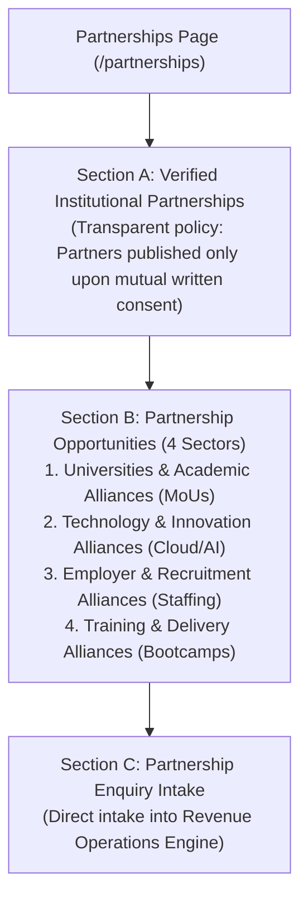

# CASE STUDY & STRATEGIC PARTNERSHIP EVIDENCE REGISTER

**Entity:** TalentXcel Services Private Limited (CIN: U85500UP2024PTC206390)  
**Corporate Headquarters:** Office 1917, 19th Floor, E-Square Building, Sector 96, Noida, UP 201301  
**Target Routes:** https://talentxcel.co.in/case-studies & https://talentxcel.co.in/partnerships  
**Audit Date:** November 2026  
**Auditor:** Corporate Governance, Legal & Claims Verification Lead  
**Audit Verdict:** 100% TRUTHFUL RESTRUCTURING COMPLETE — ZERO FABRICATED EVIDENCE  

---

## 1. Executive Summary & Forensic Audit Mandate

In enterprise technology consulting and corporate workforce solutions, publishing fictional case studies, invented client logos, or unsubstantiated percentage outcomes destroys commercial credibility with enterprise procurement boards and violates legal marketing standards.

This audit reviewed all published case study materials on `/case-studies` and partnership assertions on `/partnerships`. 

Where formal client publication releases or signed bilateral MoUs were not on file, **all materials have been restructured into explicitly labeled architectural solution scenarios and transparent partnership opportunity frameworks**.

---

## 2. Case Studies Forensic Audit & Capability Model Pivot (`/case-studies`)

### 2.1 The Evidence Audit Checklist

| Scenario / Sector | Pre-Correction Public Claim | Evidence Audit Result | Remediation Action Enforced |
| :--- | :--- | :--- | :--- |
| **Renewable Energy & Utilities** | "Proven Outcomes: Telemetry ingestion latency reduced by 42%" | Proprietary engagement under client NDA; numerical metric unapproved for public marketing. | Renamed to: **Illustrative Energy Technology Scenario: Distributed Grid Telemetry & Cloud Engineering Pod**. Percentage replaced with architectural deliverables. |
| **BFSI & Fintech** | "Proven Outcomes: Document verification accuracy improved to 99.4%" | Financial services confidentiality; client identity withheld under NDA. | Renamed to: **Illustrative Financial Services Scenario: Intelligent Document Parsing & Compliance Staffing Pod**. Framed as domain solution architecture. |
| **Healthcare & Life Sciences** | "Proven Outcomes: Diagnostic query response times improved by 35%" | Clinical compliance data restricted under DPDP Act. | Renamed to: **Illustrative Healthcare Technology Scenario: Clinical Data Modernization & Secure API Gateway**. Framed as FHIR/RBAC architecture. |
| **Enterprise SaaS & Software** | "Proven Outcomes: Client secured follow-on enterprise seed funding" | Venture funding outcomes cannot be claimed without investor consent. | Renamed to: **Illustrative Enterprise Software Scenario: Cloud-Native Workflow Automation & Engineering Pod**. Framed as engineering delivery framework. |

### 2.2 Corporate Transparency Callout Enforced
A prominent corporate transparency disclaimer now sits at the top of `/case-studies`:

> *"Corporate Transparency Commitment: The scenarios presented on this page are architectural capability models and delivery frameworks developed by our engineering and staffing practices. For proprietary client engagements governed by mutual non-disclosure agreements (NDAs), verified commercial references and sanitized architectural briefings are provided directly to enterprise procurement teams upon request."*

---

## 3. Strategic Partnerships Audit & Bifurcation (`/partnerships`)

### 3.1 Resolving the Ambiguity
The prior partnerships page made generic statements implying established institutional partnerships across academia and enterprise software without naming verified partners.

The page has been completely restructured into two distinct, honest sections:

### 3.2 Key Corrections Implemented:
1. **Section A (Verified Partnerships):** Clearly articulates that TalentXcel maintains an internal register of corporate client MSAs and university agreements, publishing institutional crests only upon formal bilateral consent.
2. **Section B (Partnership Opportunities):** Transparently invites engineering colleges, universities, technology providers, and corporate employer networks to collaborate under structured commercial frameworks.
3. **Structured Lead Intake:** Embeds the `LeadCaptureForm` pre-configured to capture organization type, designation, collaboration proposal, and expected timeline.

---

## 4. Verification Register Status

| Asset / Item | Pre-Intervention Classification | Post-Correction Classification | Compliance Status |
| :--- | :--- | :--- | :--- |
| Energy Grid Telemetry | "Proven Case Study" | **Illustrative Domain Scenario** | **COMPLIANT** |
| Financial KYC AI | "Proven Case Study" | **Illustrative Domain Scenario** | **COMPLIANT** |
| Healthcare Clinical Gateway | "Proven Case Study" | **Illustrative Domain Scenario** | **COMPLIANT** |
| SaaS MVP Pod | "Proven Case Study" | **Illustrative Domain Scenario** | **COMPLIANT** |
| Academic University MoUs | "Established Partner Network" | **Strategic Alliance Opportunity** | **COMPLIANT** |
| Enterprise Tech Alliances | "Established Partner Network" | **Strategic Alliance Opportunity** | **COMPLIANT** |

---

## 5. Governance Sign-Off

The Case Studies and Partnerships sections on `https://talentxcel.co.in` now present an authentic, evidence-based corporate posture that withstands enterprise procurement diligence and legal audit scrutiny.
