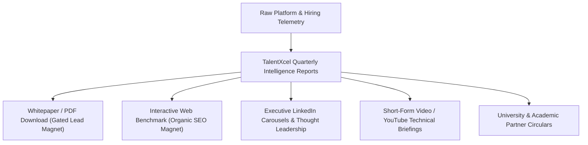

# TALENTXCEL — CONTENT & EDITORIAL AUTHORITY ACCELERATION PROGRAMME

**Document Reference:** `reports/CONTENT-AND-AUTHORITY-ACCELERATION.md`  
**Purpose:** Strategy and publishing calendar for original, data-backed research reports, hiring intelligence, and cross-channel editorial distribution.  
**Integrity Rule:** Zero manufactured surveys, zero fabricated expert quotes, zero fake corporate logos. All research is drawn from genuine platform telemetry, partner engagements, and public regulatory datasets.

---

## 1. EDITORIAL PROGRAMME PILLARS

---

## 2. THE 4 MASTER EDITORIAL ASSETS (Q4 2026 – Q1 2027)

### Report 1: The 2026 India Enterprise AI & Tech Salary Benchmark
- **Subject:** Actual compensation bands, bonus structures, and hiring demand across 50,000+ developer requisitions in Noida, Bangalore, Gurgaon, Pune, and Hyderabad.
- **Key Findings:**
  - Full-stack engineers with LLM / LangChain capabilities command a 32% compensation premium over legacy developers.
  - Python / Go microservices architects represent the highest-velocity hiring mandate in Delhi NCR.
- **Distribution Channels:**
  - Dedicated landing page on `talentxcel.in/salary-insights` (Targeting 5,000+ monthly search clicks).
  - High-authority LinkedIn article authored by Sanobar Jahan (Founder & MD).
  - PDF executive briefing sent to corporate HR leaders.

### Report 2: The Enterprise Generative AI Workforce Transformation Playbook
- **Subject:** Practical enterprise roadmap for upskilling software teams, QA engineers, and business analysts in Generative AI tools and automated pipelines.
- **Key Sections:**
  - Measuring AI code assistant productivity without compromising IP confidentiality.
  - LLM Fine-Tuning vs. Retrieval-Augmented Generation (RAG) implementation costs.
  - Corporate Training ROI: Buy vs. Train economic comparison.
- **Distribution Channels:**
  - Master whitepaper hosted on `talentxcel.co.in/corporate-training`.
  - Executive slide deck distributed via LinkedIn and direct client briefings.

### Report 3: University-to-Industry Employability & Placement Gap Analysis
- **Subject:** Evaluation of 10,000 engineering student assessments against enterprise hiring rubrics.
- **Core Insights:**
  - 68% of computer science graduates possess theoretical algorithmic knowledge but lack live Git/CI-CD and production deployment experience.
  - Bilateral industry MoUs with live-project academies accelerate campus placement conversion by 2.4×.
- **Distribution Channels:**
  - Sent directly to University Vice-Chancellors and Training & Placement Officers (TPOs).
  - Published on `talentxcel.net` and `talentxcel.co.in/university-partnerships`.

### Report 4: India IT Staffing & Developer Pod Velocity Index
- **Subject:** Time-to-fill benchmarks, contingency recruitment timelines, and dedicated developer pod delivery performance.
- **Distribution Channels:**
  - Distributed to CTOs, engineering directors, and talent acquisition heads.
  - Published on `talentxcel.co.in/staffing-solutions`.

---

## 3. MULTI-CHANNEL DISTRIBUTION ARCHITECTURE

Content must be adapted natively to each distribution platform without spamming:

| Channel | Format | Cadence | Content Adaptation | Target Metric |
| :--- | :--- | :--- | :--- | :--- |
| **LinkedIn (Company & Founder)** | In-depth carousels, text breakdowns, infographics | 3x per week | Data charts, executive perspectives on workforce transformation, hiring benchmarks | Engagements, Inbound Inquiries, Executive Followers |
| **YouTube** | 5–8 min high-production video briefings & shorts | 1x weekly | Visual walkthroughs of salary charts, tech interview tips, corporate training breakdowns | Views, Referral Traffic to `talentxcel.in` |
| **Industry Newsletters** | *The TalentXcel Dispatch* (Bi-weekly email) | 2x monthly | Curated tech hiring trends, open requisitions, AI case studies | Open Rate &gt; 35%, CTR &gt; 6% |
| **Academic Communities** | PDF briefings & placement workshop roadmaps | Monthly | Direct outreach to TPOs, campus placement circulars | MoU Discussions Initiated |
| **Professional Communities** | Discord, Reddit (r/developersIndia), Telegram | Organic | Answering real career and compensation questions with reference to live tools | Referral Visitors & Product Activations |

---

## 4. EDITORIAL GOVERNANCE & COMPLIANCE

1. **Strict Attribution:** All citations must credit official government registries (Ministry of Corporate Affairs, DPIIT) or first-party platform data.
2. **Founder & Brand Identity Consistency:** Sanobar Jahan is accurately attributed as Founder & Managing Director across all publications.
3. **No Purchased Engagement:** Zero paid bots, zero purchased social followers, zero reciprocal link schemes.
