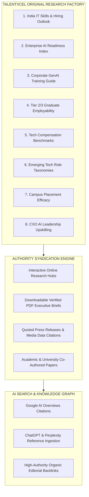
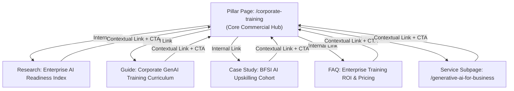
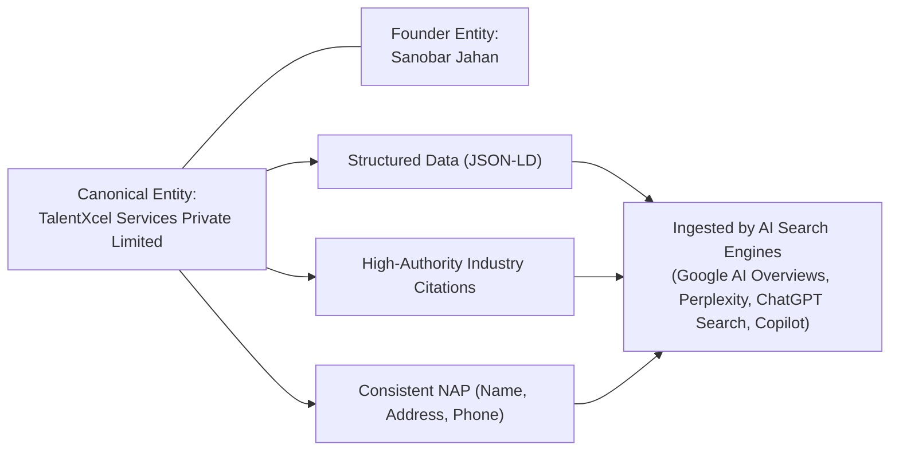

# TALENTXCEL — CONTENT AND AUTHORITY EXECUTION
## Research-Led Search Authority, Entity Optimization & Multi-Channel Distribution

**Document Reference:** `reports/CONTENT-AND-AUTHORITY-EXECUTION.md`  
**Classification:** Research Content Engine, Entity Architecture & PR Framework  
**Ecosystem Coverage:** `talentxcel.co.in`, `talentxcel.in`, `talentxcel.net`, `chatr.chat`  
**Audit Date:** November 18, 2026  
**Status:** Operational Execution Blueprint  
**Governance Standard:** Evidence-First. Zero Manufactured Backlinks. Strict E-E-A-T and AI Search Optimization.

---

## 1. THE RESEARCH-LED AUTHORITY ENGINE

To build sustainable search impressions and earn authoritative natural backlinks without relying on black-hat tactics or low-quality mass-produced content, TalentXcel's editorial strategy is anchored by **8 Flagship Original Research Programmes**.



---

## 2. THE 8 PRIORITY RESEARCH PROGRAMMES

| Programme ID | Research Title | Primary Focus & Target Audience | Core Empirical Data Source | Lead Deliverable & Format | Primary Target Search Clusters | Target Publication Window |
| :--- | :--- | :--- | :--- | :--- | :--- | :--- |
| **RES-01** | *India IT Skills & Hiring Outlook 2026* | Tech talent demand shifts, hiring velocity, remote vs hybrid trends across Tier-1 and Tier-2 hubs. | Aggregated, anonymized hiring mandate data from `talentxcel.co.in` & partner recruiters. | 36-page interactive report + downloadable PDF executive summary. | `India tech hiring trends 2026`, `software engineer demand report India` | Month 1 (Day 25) |
| **RES-02** | *Enterprise AI Workforce Readiness Index* | Audit of Generative AI adoption, tooling maturity, and skill deficits across 250+ mid-to-large Indian enterprises. | Primary survey of L&D directors, CTOs, and engineering leaders conducted by TalentXcel. | Interactive self-assessment diagnostic tool + benchmarking report. | `enterprise AI readiness India`, `generative AI skills gap corporate` | Month 2 (Day 40) |
| **RES-03** | *Corporate Generative AI Training Guide* | Practical enterprise blueprint for deploying LLMs, prompt engineering, and secure private coding assistants. | TalentXcel Enterprise AI curriculum labs and corporate delivery benchmarks. | Comprehensive technical whitepaper + implementation framework checklist. | `corporate genAI training curriculum`, `enterprise LLM upskilling guide` | Month 2 (Day 55) |
| **RES-04** | *Graduate Employability & Skill Gap Study* | Practical coding and technical competence benchmarks among 15,000 engineering graduates across Tier-2/3 institutions. | Anonymized technical assessment data from `talentxcel.net` diagnostic tests. | Annual university whitepaper co-branded with academic partners. | `engineering graduate employability India`, `campus placement skill gaps` | Month 2 (Day 60) |
| **RES-05** | *India Technology Salary & Compensation Insights* | Real-time salary percentiles across Cloud, Full-Stack, AI/ML, DevOps, and Data Science across Bangalore, NCR, Hyderabad, Pune. | Verified candidate placement records and anonymized salary disclosures on `talentxcel.in`. | Dynamic interactive salary calculator + downloadable salary table. | `data scientist salary India 2026`, `react developer salary range Noida` | Month 3 (Day 70) |
| **RES-06** | *Emerging Tech Roles & Career Taxonomies* | Job role architectures for AI Agents Engineers, MLOps Specialists, AI Safety Officers, and Quantum Computing Specialists. | Industry job descriptions analysis and technology roadmap synthesis. | Comprehensive career roadmap encyclopedia hosted on `talentxcel.in/career-guidance`. | `AI agent engineer job description`, `emerging tech roles career path` | Month 3 (Day 75) |
| **RES-07** | *Campus Placement Effectiveness Index* | Measuring the conversion rate of college placement drives into long-term retained tech hires. | Longitudinal placement tracking data across university partners. | Institutional advisory report for Deans, Chancellors, and Placement Officers. | `campus placement conversion rate`, `effective college recruitment drives` | Month 3 (Day 82) |
| **RES-08** | *Executive Leadership Upskilling in the AI Era* | Strategic study on how CXOs, VP of Engineering, and Board Members govern AI transformation. | Executive roundtables and corporate leadership interviews. | Executive monograph distributed directly to enterprise mailing lists. | `CXO AI transformation guide`, `board level generative AI governance` | Month 3 (Day 90) |

---

## 3. INTERNAL LINKING ARCHITECTURE & TOPICAL CLUSTERS

To build search topical authority, content must not exist in isolated silos. Every article, research asset, and service page is integrated into a **Hub-and-Spoke Cluster**:



### 3.1 Strict Internal Linking Rules:
1. **Descriptive Anchor Text:** Never use generic anchors like "click here", "read more", or "learn more". Always use entity-rich phrases (e.g., `explore our corporate Generative AI syllabus`, `view verified enterprise case studies`).
2. **One-Way Upward Flow:** Supporting research and blog articles must always link back up to their parent commercial pillar page with high-intent call-to-action anchors.
3. **Cross-Domain Clean Routing:** Links between domains must use full absolute URLs and open in the appropriate context, ensuring user journeys are frictionless and unambiguous.

---

## 4. AI SEARCH & ENTITY AUTHORITY (GOOGLE AI OVERVIEWS, PERPLEXITY, CHATGPT)

Modern search visibility requires optimizing for Large Language Model (LLM) search engines and the Google Knowledge Graph:



### 4.1 Founder & Company Entity Optimization
- **Official Legal Name:** TalentXcel Services Private Limited
- **Headquarters Address:** B-08, Sector 2, Noida, Uttar Pradesh 201301, India
- **Founder & Managing Director:** **Sanobar Jahan**
- **Official Enterprise Email:** `sanobar.jahan@talentxcel.co.in`
- **Structured Schema Markup:**
  - `Organization` schema implemented on `talentxcel.co.in` root.
  - `Person` schema for Sanobar Jahan detailing professional experience, leadership role, and links to verified corporate profiles.
  - `WebSite` schema on all four domains establishing ecosystem relationships via `sameAs`.

---

## 5. EXTERNAL AUTHORITY & ETHICAL PR FRAMEWORK

Backlinks are earned solely through original intellectual property, verified partnerships, and thought leadership.

### 5.1 Permitted Authority Acquisition Channels:
1. **Academic MoUs & Joint Programs:** Earning authoritative `.edu` / `.ac.in` editorial references when formal university agreements are executed.
2. **Press Data Citations:** Issuing data-driven press releases based on the 8 Research Programmes to national financial and tech press (e.g., Economic Times, LiveMint, YourStory, Inc42).
3. **Founder Guest Commentary:** Technical op-eds authored by Sanobar Jahan in enterprise HR and technology publications.
4. **Podcast & Industry Roundtables:** Participating in technology and recruitment podcasts with links to published research whitepapers.

> [!CAUTION]
> **Strict Anti-Spam Governance:**
> - Zero private blog networks (PBNs).
> - Zero paid do-follow links.
> - Zero automated link generation tools.
> - Zero comment spam or directory submissions to uncurated link farms.

---

## 6. MULTI-CHANNEL SOCIAL & VIDEO DISTRIBUTION PLAYBOOK

Every piece of original research is repurposed across high-leverage distribution channels to drive social proof and direct organic search demand:

```
+----------------------------------------------------------------------------------------------------------------+
| CONTENT MULTIPLICATION & CHANNEL DISTRIBUTION MATRIX                                                          |
+-------------------+----------------------------+-----------------------------------+---------------------------+
| Channel           | Target Audience            | Content Format                    | Call-To-Action Destination|
+-------------------+----------------------------+-----------------------------------+---------------------------+
| LinkedIn          | CXOs, HR Directors, Tech   | Slide Decks (PDF Carousels), Key  | talentxcel.co.in/         |
| (Corporate &      | Leads, Enterprise Recruiters| Data Infographics, Founder Notes | corporate-training        |
| Founder Profile)  |                            |                                   |                           |
+-------------------+----------------------------+-----------------------------------+---------------------------+
| YouTube           | Developers, Students,      | 5-10 min Video Breakdowns of      | talentxcel.net/ &         |
| (Technical Channel)| Engineers, Aspirants      | Tech Syllabi, AI Demo Walkthroughs| talentxcel.in/jobs        |
+-------------------+----------------------------+-----------------------------------+---------------------------+
| WhatsApp /        | Active Job Seekers &       | Daily Verified Job Alerts & Free  | talentxcel.in/resume-     |
| Telegram (Opt-in) | Engineering Freshers       | Diagnostic Test Links             | builder                   |
+-------------------+----------------------------+-----------------------------------+---------------------------+
| X (Twitter)       | Tech Community, AI         | Data Bite Threads, Research       | Research Hub on           |
|                   | Researchers, Founders      | Charts, Industry Commentary       | talentxcel.co.in          |
+-------------------+----------------------------+-----------------------------------+---------------------------+
```
