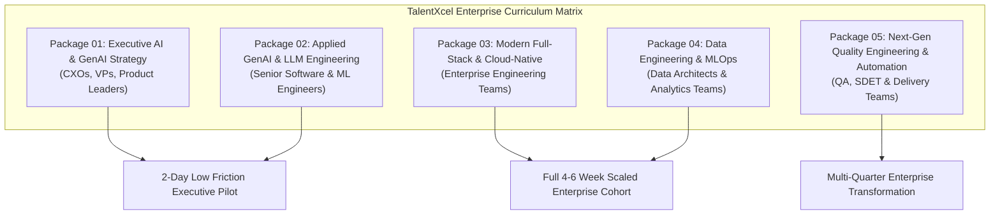
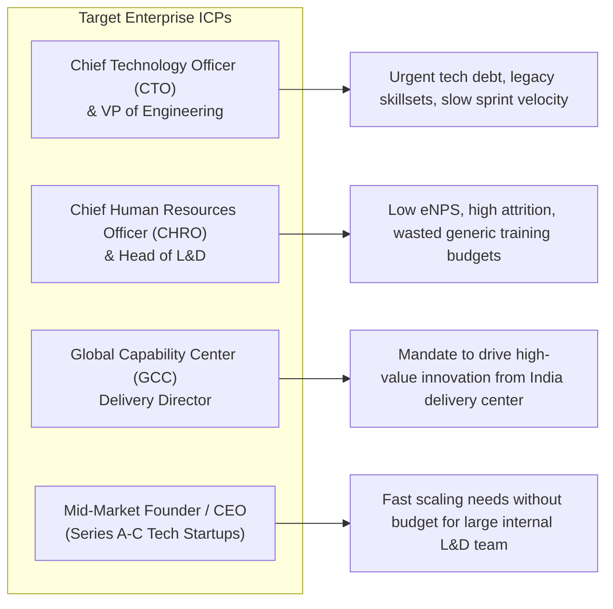

# CORPORATE TRAINING & ENTERPRISE UPSKILLING GO-TO-MARKET (GTM) STRATEGY

**Entity:** TalentXcel Services Private Limited (CIN: U85500UP2024PTC206390)  
**Corporate Headquarters:** Office 1917, 19th Floor, E-Square Building, Sector 96, Noida, UP 201301  
**Target Revenue Engine:** Pillar 01 — Corporate Training & Learning Solutions  
**URL Architecture:** https://talentxcel.co.in/corporate-training  
**Publication Date:** November 2026  
**Author:** Chief Growth Officer & Enterprise L&D Practice Lead  

---

## 1. Commercial Thesis & Market Opportunity

Indian enterprises, GCCs (Global Capability Centers), and high-growth technology firms are caught in a severe talent displacement cycle. Over 70% of enterprise leaders report that existing software engineering cohorts lack practical competence in deploying Generative AI models, agentic workflows, cloud-native containerization, and automated CI/CD pipelines.

Concurrently, corporate buyers are disillusioned with legacy L&D catalogs (e.g., massive asynchronous libraries with sub-20% completion rates). Enterprise decision-makers demand **outcome-oriented, cohort-based, live practitioner-led upskilling** directly connected to immediate business roadmaps.

TalentXcel's Corporate Training Go-To-Market strategy establishes a high-margin, repeatable B2B revenue engine built around 5 productized commercial training packages, clear pricing tiers, risk-mitigated pilots, and rigorous sales qualification.

---

## 2. Productized Corporate Training Curriculum Catalog

TalentXcel packages enterprise training into five standardized, commercially priced offerings. Each package includes pre-assessment diagnostic rubrics, hands-on cloud sandbox labs, capstone project evaluation, and post-training competency certification.

### Package 01: Executive AI & GenAI Strategy for Business Leaders
- **Target Audience:** CXOs, Business Unit Heads, Enterprise Architects, Product Directors, VPs of Digital Transformation.
- **Duration:** 2 Days Intensive (16 Hours total) or 4 Half-Day Executive Sessions.
- **Core Modules:**
  1. *Deconstructing GenAI Economics:* Token costs, model sizing, open-source (Llama/Mistral) vs. proprietary APIs (Gemini/OpenAI), TCO calculation.
  2. *Enterprise Risk, Governance & IP:* Data leakage prevention, private RAG architectures, hallucination mitigation, EU AI Act & Indian DPDP compliance.
  3. *Building Agentic Business Processes:* Autonomous multi-agent workflows, customer operations automation, intelligent code assistance ROI.
  4. *Prioritizing High-ROI AI Pilots:* Capstone framework evaluating feasibility, data readiness, and commercial value.
- **Commercial Price:** INR 1,80,000 to INR 2,75,000 per cohort (capped at 15 leaders).

### Package 02: Applied Generative AI & LLM Engineering for Technical Teams
- **Target Audience:** Senior Software Engineers, ML Practitioners, Tech Leads, Cloud Architects.
- **Duration:** 4 Weeks (36 Hours total — 2 evening sessions/week + Saturday intensive).
- **Core Modules:**
  1. *Advanced Prompt Engineering & Structured Outputs:* Pydantic schemas, function calling, tool use, prompt security.
  2. *Production RAG Systems:* Chunking strategies, hybrid search, dense/sparse vector indexing, re-ranking, evaluating retrieval with RAGAS.
  3. *Fine-Tuning & Quantization:* LoRA, QLoRA, parameter-efficient fine-tuning on domain-specific datasets, local execution with Ollama/vLLM.
  4. *Multi-Agent Systems & LangGraph:* Orchestrating stateful, multi-turn autonomous agents with human-in-the-loop controls.
- **Commercial Price:** INR 3,50,000 to INR 5,20,000 per cohort (15–25 engineers).

### Package 03: Modern Full-Stack & Cloud-Native Engineering Bootcamp
- **Target Audience:** Enterprise Software Developers transitioning from legacy monoliths to modern distributed architectures.
- **Duration:** 6 Weeks (48 Hours total).
- **Core Modules:**
  1. *Modern Frontend Architecture:* React 18/19, TypeScript strict mode, state management, micro-frontends, Core Web Vitals optimization.
  2. *Cloud-Native Backend & Microservices:* Node.js, Go/Python FastAPI, RESTful contracts, gRPC, asynchronous event-driven queues (Kafka/RabbitMQ).
  3. *Containers, Orchestration & DevOps:* Docker multi-stage builds, Kubernetes pod deployment, GitOps workflows (GitHub Actions, ArgoCD).
  4. *Secure API Design & Performance:* OAuth2/OIDC, rate limiting, distributed caching with Redis, observability with OpenTelemetry.
- **Commercial Price:** INR 4,20,000 to INR 6,50,000 per cohort (20–30 engineers).

### Package 04: Data Engineering, Modern Analytics & MLOps
- **Target Audience:** Data Analysts, BI Engineers, Aspiring Data Engineers and MLOps Specialists.
- **Duration:** 5 Weeks (40 Hours total).
- **Core Modules:**
  1. *Modern Data Stack:* Lakehouse architecture (Delta Lake / Apache Iceberg), dbt for modular SQL modeling, Snowflake/Databricks operations.
  2. *Data Pipelines & Orchestration:* Apache Airflow, DAG design, automated schema migration, data quality testing with Great Expectations.
  3. *MLOps Pipelines:* Model registry, MLflow, feature stores, automated CI/CD for model deployment, drift monitoring in production.
- **Commercial Price:** INR 3,80,000 to INR 5,80,000 per cohort (15–25 engineers).

### Package 05: Next-Gen Enterprise Quality Engineering & Test Automation
- **Target Audience:** Manual QA teams, SDETs, Test Automation Leads.
- **Duration:** 3 Weeks (24 Hours total).
- **Core Modules:**
  1. *Modern Test Frameworks:* Playwright and Cypress end-to-end automation with TypeScript, visual regression testing.
  2. *API & Performance Testing:* Postman automation, Newman CLI in pipelines, load testing with k6.
  3. *AI-Powered Testing:* Generating dynamic test vectors with LLMs, automated defect triaging, synthetic test data generation.
- **Commercial Price:** INR 2,50,000 to INR 3,80,000 per cohort (15–25 engineers).

---

## 3. Commercial Pricing Architecture & Deal Packaging

TalentXcel employs a 3-tier engagement model designed to remove buyer friction, secure budget approvals quickly, and expand accounts into recurring annual L&D relationships.

| Engagement Tier | Scope & Commitment | Target Buyer Problem | Commercial Pricing (INR) | Payment Terms |
| :--- | :--- | :--- | :--- | :--- |
| **Tier 1: Enterprise Diagnostic Pilot** | 2-Day live workshop (12–16 hrs) on 1 selected technical track. Maximum 15 participants. | High skepticism of third-party trainers; needs to validate instructor credibility without procurement committee delay. | **INR 1,80,000** ($2,400 USD for global clients) | 100% advance or 50% on booking / 50% on completion. |
| **Tier 2: Standard Cohort Acceleration** | 4-to-6 week specialized bootcamp (30–48 hrs) tailored to client's repo and stack. Up to 25 engineers. | Critical project delivery impending; internal skills gap blocking engineering sprint cadence. | **INR 3,50,000 – INR 5,50,000** ($4,500 – $7,200 USD) | 50% upon signing, 50% upon mid-term milestone delivery. |
| **Tier 3: Enterprise Transformation Retainer** | Quarterly or Annual L&D partnership covering multiple cohorts (100+ engineers) across 3+ tracks. | Ongoing enterprise re-skilling; new hire onboarding academies; continuous architecture modernization. | **INR 12,00,000 – INR 35,00,000+** / year | Quarterly billing with net-30 terms against predefined cohort schedules. |

---

## 4. Ideal Customer Profiles (ICPs) & Target Stakeholders

To maximize sales conversion, TalentXcel concentrates business development on 4 distinct buyer personas:

1. **The CTO / VP of Engineering:**
   - *Key Concern:* Time to productivity, code quality, adoption of modern tools (GenAI copilots, containerization).
   - *Value Hook:* "We don't teach slides. Your engineers build working prototypes in live cloud sandboxes aligned to your microservices."
2. **The Head of L&D / CHRO:**
   - *Key Concern:* Budget efficiency, employee participation rates, measurable ROI reporting.
   - *Value Hook:* "Guaranteed >85% attendance and measurable pre/post skill benchmark assessments delivered to your leadership dashboard."
3. **The GCC / Captive Center Managing Director:**
   - *Key Concern:* Moving Indian engineering teams up the value chain from maintenance to core product ownership.
   - *Value Hook:* "Accelerate the transition from offshore execution to technical architectural leadership with our specialized enterprise cohorts."

---

## 5. B2B Sales Cadence & Outreach Framework

### 5.1 Sales Cadence (14-Day Multi-Touch Playbook)
- **Day 1 (LinkedIn Connection + Personalized Note):** Reference specific company hiring requisitions or technology announcements (e.g., "Noticed you are scaling your platform team in Noida/NCR...").
- **Day 3 (Cold Email 1 — Value Hook & Pilot Proposition):** Share curriculum overview of Package 02 (Applied GenAI) and propose the 2-Day Executive Diagnostic Pilot.
- **Day 6 (Follow-Up Email 2 — Diagnostic Rubric):** Share a sample "Skills Competency Matrix" for engineering teams to evaluate their current readiness.
- **Day 9 (LinkedIn Engagement / Voice Note):** Congratulate on recent corporate milestone; inquire on Q1/Q2 upskilling priorities.
- **Day 12 (Cold Email 3 — Social Proof & Urgency):** Highlight immediate trainer availability in the Noida/Delhi-NCR technology corridor.
- **Day 14 (Breakup / Permission to Close File):** Cordial note acknowledging timing may not be optimal; offer to leave syllabus on file for future budget cycles.

### 5.2 Enterprise Email Template (High-Converting Cold Outreach)

> **Subject:** Upskilling [Company Name]'s engineering cohort on production GenAI & LLMs  
> 
> Hi [First Name],  
> 
> When speaking with engineering leaders in [City / NCR], we frequently hear that while software teams are experimenting with LLM APIs, building robust, low-latency, and cost-controlled enterprise GenAI pipelines remains a significant hurdle.  
> 
> At **TalentXcel** (Noida Sector 96), we deliver customized, practitioner-led corporate engineering bootcamps designed to solve this exact bottleneck. Unlike generic video platforms, our programs are 100% live and lab-driven:  
> - **Applied LLM Engineering:** Production RAG, LangGraph multi-agent orchestration, and token economics.  
> - **Modern Cloud-Native:** Microservices, Docker, Kubernetes, and enterprise CI/CD.  
> 
> We recently opened Q1 scheduling for our **2-Day Executive Diagnostic Pilot** (capped at 15 engineers), designed to prove tangible upskilling outcomes before committing to large-scale training budgets.  
> 
> Do you have 10 minutes this Thursday afternoon to discuss if this fits [Company Name]'s technical roadmap?  
> 
> Best regards,  
> **Enterprise Learning Practice**  
> TalentXcel Services Private Limited  
> Office 1917, E-Square Building, Sector 96, Noida | +91 98711 70000 | https://talentxcel.co.in/corporate-training  

---

## 6. Delivery Modalities & Quality Assurance

To ensure consistent educational outcomes, TalentXcel operates three certified delivery modalities:

1. **Instructor-Led Virtual Classrooms (Live ILT):**
   - Conducted via high-definition video conferencing with dual-monitor screen share capabilities.
   - Live code pairing via shared cloud sandboxes (GitHub Codespaces / AWS Cloud9).
   - Session recordings, transcribed searchable notes, and repository commits archived for 12 months.
2. **On-Premise Corporate Delivery:**
   - Dedicated master trainers deployed directly to client office facilities across Noida, Delhi-NCR, Gurugram, Bengaluru, and major metro hubs.
   - Ideal for high-security environments where source code cannot leave internal corporate subnets.
3. **Executive Hybrid Immersive:**
   - Blended kickoff workshop on-premise followed by virtual hands-on sprint reviews and capstone evaluation panels.

---

## 7. Operational SLA & Revenue Milestones

- **Inquiry Response SLA:** < 15 minutes during Indian business hours; automated confirmation reference dispatched immediately.
- **Proposal Delivery SLA:** Standardized training scope & commercial quote delivered within 24 hours of discovery call.
- **Q1 Revenue Milestone:** 4 Corporate Training Cohorts closed = **INR 14,00,000 to INR 20,00,000**.
- **Annual Target (Year 1):** 30 Enterprise Cohorts + 5 Annual Retainers = **INR 1.25 Crore to INR 1.65 Crore**.
