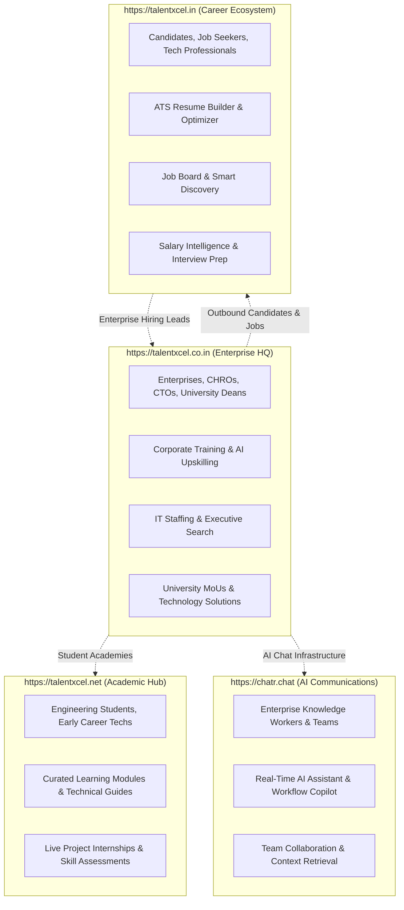

# TALENTXCEL — DOMAIN-BY-DOMAIN 5X ORGANIC GROWTH PLAN

**Document Reference:** `reports/DOMAIN-BY-DOMAIN-GROWTH-PLAN.md`  
**Scope:** Specific tactical execution blueprints for all four ecosystem domains.  
**Core Rule:** Every domain operates with distinct audience journeys, tailored content strategies, and commercial conversion funnels. Duplicate content across domains is strictly forbidden.

---

## 1. ECOSYSTEM ARCHITECTURE & AUDIENCE TOPOLOGY

---

## 2. DOMAIN 1: `talentxcel.co.in` — CORPORATE & B2B REVENUE ENGINE

### 2.1 Strategic Mission
Transform `talentxcel.co.in` into the central demand generation engine for corporate training cohorts, staffing mandates, university alliances, and enterprise software contracts.

### 2.2 Content Pillars & High-Intent Landing Pages
1. **Corporate AI & Workforce Training (`/corporate-training`):**
   - **Target Audience:** CHROs, CLOs, VPs of Engineering, Learning & Development Directors.
   - **Content Modules:**
     - Generative AI for Engineers & Product Teams.
     - Enterprise LLM Architecture, Fine-Tuning & Prompt Engineering.
     - Cloud Native Microservices (AWS, Azure, GCP).
     - Full-Stack Modernization & DevOps Automation.
   - **Conversion Asset:** "Download 2026 Enterprise AI Curriculum PDF" & `LeadCaptureForm`.
2. **Specialized IT Staffing & Developer Pods (`/staffing-solutions`):**
   - **Target Audience:** CTOs, Engineering Managers, Tech Founders.
   - **Content Modules:**
     - Dedicated Engineering Pods (Turnkey squad of 4–8 developers + Tech Lead).
     - Contingency Direct Hire (Mid to Senior Leadership).
     - Contract-to-Hire and Managed IT Staffing.
     - Transparent Commercial Terms (8.33% standard direct hire fee structure).
   - **Conversion Asset:** "Initiate Pod Scoping Call" & `LeadCaptureForm`.
3. **University & Institutional Partnerships (`/university-partnerships`):**
   - **Target Audience:** University Vice-Chancellors, Placement Deans, TPOs.
   - **Content Modules:**
     - Bilateral MoU Framework for Engineering & Technology Campuses.
     - Live-Project Industry Internships (Full-Stack, Python/AI, Cloud).
     - Faculty Development Programs (FDP).
   - **Conversion Asset:** "Initiate Bilateral MoU Discussion" & `LeadCaptureForm`.
4. **Enterprise Technology Solutions (`/services`):**
   - Software Engineering, Cloud Telemetry, Business Automation, Architecture Consulting.

### 2.3 Acquisition & Lead Routing Architecture
- Every high-intent page embeds `LeadCaptureForm`.
- All leads automatically dispatch to **`sanobar.jahan@talentxcel.co.in`** (CC: `enterprise@talentxcel.co.in`, `contact@talentxcel.co.in`).
- Real-time logging into `revenueOperations` for pipeline stage tracking.

---

## 3. DOMAIN 2: `talentxcel.in` — CAREER & PROFESSIONAL PLATFORM

### 3.1 Strategic Mission
Deliver high-utility career tools that solve genuine job search problems, driving organic word-of-mouth and top-of-funnel search traffic without programmatic spam.

### 3.2 Product Utility Priorities
1. **ATS Resume Builder & Scoring Engine:**
   - Real ATS algorithm simulation (identifying missing skills, formatting errors, weak action verbs).
   - Instant score benchmark (0–100) with downloadable optimized PDF.
   - *Growth Metric:* Completed Resume Optimizations.
2. **Verified Tech Job Discovery:**
   - Real-time job feeds categorized by tech stack (Python, React, Go, Java, DevOps, Data Science).
   - Implementation of Google `JobPosting` structured schema for organic Google Jobs rich snippet inclusion.
   - *Growth Metric:* Applications Submitted.
3. **Salary Intelligence Engine:**
   - Real compensation benchmarks across Indian tech hubs (Noida, Bangalore, Gurgaon, Pune, Hyderabad).
   - Interactive seniority slider (Junior 0–2y, Mid 3–5y, Senior 6–10y, Lead 10y+).
   - *Growth Metric:* Salary Report Views & Registrations.
4. **Interview Preparation Hub:**
   - Curated technical coding questions, system design walkthroughs, and HR interview guides.

### 3.3 Programmatic SEO Governance
- **Freeze Enforced:** Zero automated generation of thousands of thin "job in [village/city]" URLs.
- Every indexed URL must have unique content, verified salary ranges, or interactive tools.
- **Activation Over Registration:** A registered user who does not upload a resume or apply for a role is tracked as inactive.

---

## 4. DOMAIN 3: `talentxcel.net` — LEARNING & ACADEMIC HUB

### 4.1 Strategic Mission
Serve students, fresh graduates, and career changers with verified learning resources, academic pathways, and employability preparation.

### 4.2 Content & Product Guidelines
- **Strict Authenticity Principle:** Zero claims of proprietary degree accreditations or fictitious government affiliations.
- Focus on:
  - Open-source learning roadmaps (Frontend, Backend, DevOps, Data Engineering).
  - Practice coding exercises and technical assessments.
  - Academic internship guides and industry project briefs.
- **Ecosystem Cross-Link:** High-performing students on `talentxcel.net` are introduced to `talentxcel.in` for placement opportunities and `talentxcel.co.in` for corporate internship academies.

---

## 5. DOMAIN 4: `chatr.chat` — AI COMMUNICATIONS & PRODUCTIVITY

### 5.1 Strategic Mission
Acquire knowledge workers, developers, and distributed teams seeking fast, contextual AI assistance.

### 5.2 Search & Discovery Pillars
1. **Real Use Cases Over Generic Buzzwords:**
   - Avoid generic keywords like "best ai 2026".
   - Target solution queries: `ai code assistant for python development`, `automated meeting notes extraction`, `secure internal team chat with ai context`.
2. **Product Activation Metric:**
   - Organic success is measured by **first conversation completed** within 3 minutes of arrival, not bounce visits.
