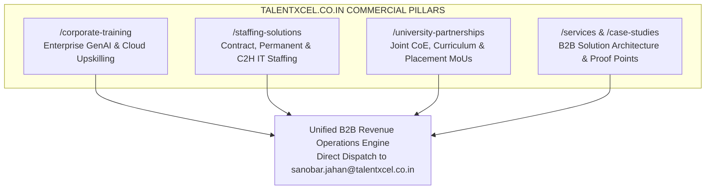

# TALENTXCEL — DOMAIN-LEVEL SEARCH GROWTH PLAN
## Four-Domain Ecosystem Positioning, Technical Architecture & Audience Segmentation

**Document Reference:** `reports/DOMAIN-LEVEL-SEARCH-GROWTH-PLAN.md`  
**Classification:** Multi-Domain Search Architecture & Go-To-Market Blueprint  
**Ecosystem Coverage:** `talentxcel.co.in`, `talentxcel.in`, `talentxcel.net`, `chatr.chat`  
**Audit Date:** November 18, 2026  
**Status:** Architecture Finalized & Operationalized  
**Governance Standard:** Absolute Domain Separation. Zero Cross-Domain Content Duplication.

---

## 1. ECOSYSTEM ARCHITECTURE & SEPARATION MATRIX

The TalentXcel ecosystem operates four distinct web properties. Each property serves an exclusive audience, targets separate search intent clusters, and deploys specialized technical rendering stacks:

```
+-------------------------------------------------------------------------------------------------------------------------+
| ECOSYSTEM DOMAIN SEPARATION & TECHNICAL GOVERNANCE MATRIX                                                              |
+-------------------+----------------------------+-----------------------------------+-------------------+----------------+
| Domain            | Primary Audience           | Core Commercial / Search Identity | Technology Stack  | Rendering Mode |
+-------------------+----------------------------+-----------------------------------+-------------------+----------------+
| talentxcel.co.in  | Enterprise CXOs, HR Heads, | B2B Corporate Upskilling, IT      | React / Vite /    | Client-Side    |
|                   | L&D Directors, Deans       | Staffing, University MoUs         | Tailwind (Vercel) | SPA + rewrites |
+-------------------+----------------------------+-----------------------------------+-------------------+----------------+
| talentxcel.in     | Candidates, Job Seekers,   | Job Board, AI Resume Builder,     | Next.js / Node /  | Hybrid ISR /   |
|                   | Freshers, Recruiters       | Public Salary Insights            | Vercel            | SSR            |
+-------------------+----------------------------+-----------------------------------+-------------------+----------------+
| talentxcel.net    | K-12 Students, Parents,    | Academic Diagnostic Tests, JEE/   | Next.js App       | SSR Pre-render |
|                   | Educators, School Boards   | NEET Foundation Gap Analysis      | Router (Vercel)   | (`x-nextjs:1`) |
+-------------------+----------------------------+-----------------------------------+-------------------+----------------+
| chatr.chat        | Modern Teams, Global       | Real-Time Multilingual Messaging, | WebRTC / React /  | SPA + WebSocket|
|                   | Enterprises, Professionals | Browser Calling, Live Translation | Cloudflare / Nginx| Edge           |
+-------------------+----------------------------+-----------------------------------+-------------------+----------------+
```

---

## 2. DOMAIN A: TALENTXCEL.CO.IN — ENTERPRISE REVENUE & CORPORATE AUTHORITY

`https://talentxcel.co.in` is the flagship corporate authority asset. Its search strategy focuses on high-ticket B2B enterprise procurement, institutional leadership partnerships, and specialized tech staffing.



### 2.1 Keyword & Content Clusters
1. **Corporate Training & AI Upskilling (`/corporate-training`):**
   - *Target Queries:* `corporate AI training India`, `generative AI upskilling for enterprise`, `custom tech workforce training programs`, `enterprise LLM adoption training Noida`.
   - *Search Intent:* B2B Commercial & Transactional.
   - *Content Architecture:* Dedicated modular syllabi for Executives, Software Engineers, and Operations Teams; interactive ROI calculator for enterprise L&D; verifiable enterprise case studies.
2. **IT Staffing & Technical Recruitment (`/staffing-solutions`):**
   - *Target Queries:* `IT staffing solutions India`, `hire contract React developers`, `tech talent recruitment agency Noida`, `executive search technology leaders`.
   - *Search Intent:* B2B Transactional.
   - *Content Architecture:* 72-hour talent deployment SLA, transparent 5-stage vetting pipeline, flexible engagement models (T&M, C2H, dedicated offshore teams).
3. **University Partnerships & Academia (`/university-partnerships`):**
   - *Target Queries:* `university corporate placement training partner`, `engineering college AI curriculum MoU`, `campus recruitment readiness program`.
   - *Search Intent:* Institutional Institutional B2B.
   - *Content Architecture:* NAAC-aligned technical syllabi, Center of Excellence (CoE) framework blueprints, joint industrial certification workflows.

### 2.2 Conversion & Lead Routing Integration
- **Lead Capture:** Forms on `/corporate-training`, `/staffing-solutions`, `/university-partnerships`, and `/contact`.
- **Backend Routing:** Processed via `src/services/revenueOperations.ts` and dispatched directly to **Sanobar Jahan** (`sanobar.jahan@talentxcel.co.in`), with CC routing to dedicated Zoho alias departments (`enterprise@`, `careers@`, `investors@`).
- **Data Protection:** Strict DPDP Act 2023 compliance with explicit consent logging and zero third-party cookie leakage.

---

## 3. DOMAIN B: TALENTXCEL.IN — CANDIDATE & JOBSEEKER DISCOVERY ENGINE

`https://talentxcel.in` is the primary high-volume traffic engine of the ecosystem, designed to capture 70% of the 100M impression ambition through job searchers, freshers, and tech professionals.

### 3.1 Technical Governance & Programmatic SEO Freeze
> [!IMPORTANT]
> **Strict Publishing Freeze:** Programmatic generation of thousands of thin location/skill combination pages is **frozen** until the technical foundation is repaired. Uncontrolled mass page publishing without verified job data risks algorithmic thin-content penalties from Google.

### 3.2 Immediate Technical Remediation Tasks
1. **Fix Broken Commercial Deep-Links:**
   - `/salary-insights` currently returns HTTP 404 → Restore interactive salary benchmark explorer.
   - `/career-guidance` currently returns HTTP 404 → Deploy verified career progression roadmaps for top 25 tech roles.
2. **Google for Jobs Schema Implementation:**
   - Inject `JobPosting` schema on all live job listing pages:
   ```json
   {
     "@context": "https://schema.org/",
     "@type": "JobPosting",
     "title": "Senior Full-Stack Engineer",
     "description": "...",
     "datePosted": "2026-11-18",
     "validThrough": "2026-12-31",
     "employmentType": "FULL_TIME",
     "hiringOrganization": {
       "@type": "Organization",
       "name": "TalentXcel",
       "sameAs": "https://talentxcel.co.in"
     },
     "jobLocation": {
       "@type": "Place",
       "address": {
         "@type": "PostalAddress",
         "addressLocality": "Noida",
         "addressRegion": "UP",
         "addressCountry": "IN"
       }
     },
     "baseSalary": {
       "@type": "MonetaryAmount",
       "currency": "INR",
       "value": {
         "@type": "QuantitativeValue",
         "minValue": 1200000,
         "maxValue": 2400000,
         "unitText": "YEAR"
       }
     }
   }
   ```
3. **Faceted Navigation Hygiene:**
   - Configure canonical tags on filtered searches (`/jobs?role=dev&loc=noida&exp=2`) to point to clean canonical category URLs (`/jobs/software-developer-noida`).
   - Implement `noindex, follow` on infinite pagination parameters beyond page 10.

---

## 4. DOMAIN C: TALENTXCEL.NET — K-12 ACADEMIC LEARNING & DIAGNOSTIC ASSESSMENTS

`https://talentxcel.net` is dedicated exclusively to academic education, competitive examinations, and student learning gap diagnostics.

### 4.1 Boundary Enforcement
- **Absolute Rule:** Zero corporate training or IT staffing content on `talentxcel.net`.
- **Target Audience:** School students (Classes 4–12), parents evaluating academic performance, educators, and competitive exam aspirants (JEE Main/Advanced, NEET, Olympiads).

### 4.2 Search Acquisition Engine
1. **Diagnostic Test Directory:**
   - Pre-rendered SSR pages for every class and subject (e.g., `/class-10/cbse-mathematics-diagnostic-test`, `/jee/physics-mechanics-concept-test`).
   - Each page delivers instant interactive practice questions, instant diagnostic scoring, and personalized topic-level remediation recommendations.
2. **Schema.org Learning Resources:**
   - Structured data using `LearningResource`, `Quiz`, and `EducationalOccupationalCredential`.
   - Rich results for educational questions in Google SERPs.

---

## 5. DOMAIN D: CHATR.CHAT — AI MULTILINGUAL COMMUNICATION PLATFORM

`https://chatr.chat` is the technology platform brand focused on product-led growth (PLG) for real-time multilingual messaging, voice, and video calling.

### 5.1 Technical Remediation
1. **Port 80 HTTP-to-HTTPS Enforcement:**
   - Probes confirmed `http://chatr.chat` returns HTTP 200 without redirecting.
   - Deploy immediate 301 Permanent Redirect at Nginx/Cloudflare edge:
   ```nginx
   server {
       listen 80;
       server_name chatr.chat www.chatr.chat;
       return 301 https://chatr.chat$request_uri;
   }
   ```
2. **Product-Led Search Positioning:**
   - Target queries: `real-time voice translation online`, `secure browser video calling no download`, `AI multilingual team messaging`.
   - Add interactive live sandbox on homepage allowing users to test instant voice translation between English, Hindi, Tamil, Telugu, and German directly in the browser.
