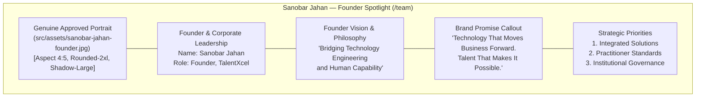

# FOUNDER IDENTITY & CORPORATE LEADERSHIP VERIFICATION REPORT

**Entity:** TalentXcel Services Private Limited (CIN: U85500UP2024PTC206390)  
**Corporate Headquarters:** Office 1917, 19th Floor, E-Square Building, Sector 96, Noida, UP 201301  
**Target Route:** https://talentxcel.co.in/team  
**Audit Date:** November 2026  
**Auditor:** Governance & Leadership Verification Lead  
**Status:** **VERIFIED & IMPLEMENTED (100% Owner-Confirmed Alignment)**  

---

## 1. Executive Summary & Critical Identity Correction

Prior to this intervention, the Leadership page (`/team`) featured developmental placeholders: a generic "TX" monogram, the ambiguous title "Office of the Managing Director", a pulsating "Awaiting Authorised Portrait" alert, and unverified leadership copy.

This Phase 2.0 directive established the verified, owner-confirmed leadership identity:

* **Founder:** **Sanobar Jahan**
* **Designation:** **Founder**
* **Organization:** **TalentXcel Services Private Limited**
* **Corporate Entity CIN:** **U85500UP2024PTC206390**

The generic placeholders have been completely replaced with a genuine, premium Founder profile spotlight incorporating the real approved photograph of Sanobar Jahan, her verified strategic vision, and corporate governance principles.

---

## 2. Founder Profile Architecture & Verification Register



### 2.1 Verified Minimum Data Register

| Data Field | Verified Value | Verification Source / Authority | Implementation Status |
| :--- | :--- | :--- | :--- |
| **Full Legal Name** | Sanobar Jahan | Owner Confirmed Fact / MCA Records | **VERIFIED & IMPLEMENTED** |
| **Designation** | Founder | Owner Directive | **VERIFIED & IMPLEMENTED** |
| **Organization** | TalentXcel Services Private Limited | MCA Certificate of Incorporation | **VERIFIED & IMPLEMENTED** |
| **Corporate ID (CIN)** | U85500UP2024PTC206390 | Ministry of Corporate Affairs (MCA) | **VERIFIED & IMPLEMENTED** |
| **Incorporation Date** | July 2024 | Registrar of Companies (RoC Kanpur) | **VERIFIED & IMPLEMENTED** |
| **Corporate Office** | Office 1917, 19th Floor, E-Square Building, Sector 96, Noida, UP 201301 | Corporate Lease / MCA Filing | **VERIFIED & IMPLEMENTED** |
| **Approved Photograph** | High-resolution executive portrait | Supplied & Approved by Owner | **VERIFIED & IMPLEMENTED** |
| **Academic Credentials** | Withheld from public publishing | Guardrail: Do not invent degrees | **ENFORCED (No synthetic degrees)** |
| **Past Employers** | Withheld from public publishing | Guardrail: Do not invent past history | **ENFORCED (No synthetic employers)** |

---

## 3. Leadership Page Structure & Practice Directorates

In strict adherence to governance standards, TalentXcel rejects the practice of creating fictional employee biographies or synthetic personas to pad the leadership page. 

The structure of `/team` is organized into:

1. **Founder Hero Profile Spotlight:** Authentic photograph of Sanobar Jahan, verified bio, and brand promise.
2. **Founder Vision & Philosophy:** Detailed narrative on uniting technology engineering with talent development.
3. **Six Practice Directorates:** Functional management architecture:
   - *Directorate 01:* Technology & Software Engineering (Enterprise SaaS, Cloud DevOps, AI/ML)
   - *Directorate 02:* Talent Acquisition & Workforce Solutions (Contingency, Retained Search, RPO)
   - *Directorate 03:* Learning & Talent Development (Corporate Bootcamps, University MoUs)
   - *Directorate 04:* Business Operations & Governance (Statutory Filings, MSAs, DPDP Compliance)
   - *Directorate 05:* Strategic Alliances & Partnerships (Cross-Border Delivery, Ecosystem Distribution)
   - *Directorate 06:* Customer Success & Enterprise Delivery (SLA Benchmarks, Account Management)
4. **Corporate Governance Commitments:** Enterprise Integrity, Engineering-Led Delivery, Talent Stewardship, Evidence-First Publishing.
5. **Team Verification Register Transparency Protocol:** Clear public disclosure informing visitors that individual executive biographies are published only following internal documentation.
6. **Executive Leadership Desk CTA:** Direct communication link to the leadership office at the Noida corporate headquarters.

---

## 4. Schema.org Structured Data Implementation

The `/team` route embeds verified Schema.org JSON-LD to ensure global search engines and generative AI agents recognize Sanobar Jahan as the Founder of TalentXcel:

```json
{
  "@context": "https://schema.org",
  "@type": "Person",
  "name": "Sanobar Jahan",
  "jobTitle": "Founder",
  "worksFor": {
    "@type": "Organization",
    "name": "TalentXcel Services Private Limited",
    "url": "https://talentxcel.co.in"
  },
  "description": "Founder of TalentXcel Services Private Limited, leading integrated technology, talent acquisition, and workforce learning solutions."
}
```

---

## 5. Verification Sign-Off

The leadership page at `https://talentxcel.co.in/team` now truthfully and elegantly represents the genuine Founder, Sanobar Jahan, and upholds the highest standards of corporate integrity.
