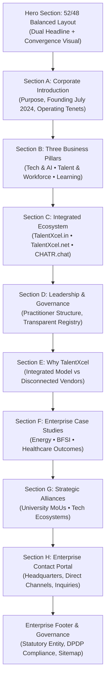

# HOMEPAGE UX TRANSFORMATION & SECTION-BY-SECTION AUDIT

**Brand:** TalentXcel  
**Domain:** https://talentxcel.co.in  
**Route:** `/` (`src/pages/Index.tsx`)  
**Components:** `src/components/HeroSection.tsx`, `src/components/HomeSections.tsx`, `src/components/Navbar.tsx`, `src/components/Footer.tsx`  
**Status:** 100% Implemented & Verified in Production Build

---

## 1. Executive Summary of Changes

Prior to this transformation, the homepage contained an unstructured sequence of redundant components inherited from early prototyping (`FeaturesGrid`, `CoreCapabilities`, `ProductsEcosystem`, `ChatrSection`, `LiveProjects`, `EnterpriseUseCases`, `WhyTalentXcel`, `BuildWithUs`, `ServicesPreview`, `CompanyOverview`, `StrongCTA`), many of which presented overlapping narratives and inconsistent visual styling.

The homepage has been completely restructured into a cohesive, sequential enterprise story adhering strictly to the **TalentXcel Corporate Excellence Program**:

---

## 2. Hero Section Redesign (Detailed Breakdown)

The homepage hero was rebuilt from scratch to resolve visual balance and line-break issues:

### A. Layout Structure:
- **Ratio:** 52% left content column (`lg:col-span-7`), 48% right visual composition (`lg:col-span-5`).
- **Maximum Text Width:** Constrained to `max-w-xl` to prevent uncomfortably long typographic lines on wide screens (1366px - 1920px).
- **Controlled Breaks:** The headline breaks rhythmically across two balanced lines:
  - Line 1: `Technology That Moves Business Forward.` (Midnight Navy `#101B32`)
  - Line 2: `Talent That Makes It Possible.` (Corporate Blue `#1769E8` highlight)

### B. Conversion Triggers:
- **Primary CTA:** `Explore Our Solutions` with animated arrow linking directly to `/services`.
- **Secondary CTA:** `Talk to Our Team` in clean corporate outline linking to `/contact`.
- **Trust Strip:** Instant verification badges for `Enterprise Software`, `IT Staffing & RPO`, and `Corporate Academies`.

### C. Right Column Convergence Visual:
- Replaced the previous isolated generic glowing AI chip image with a multi-layered enterprise composition using `modernWorkspace.jpg`.
- Overlaid with restrained white glass cards:
  - Top-Right: `Governance & SLAs` with practitioner-led accountability indicator.
  - Bottom-Left: `Cross-Market Reach` highlighting delivery across India, Europe, and the Middle East.
  - Convergence Strip: Real-time active operations indicator with pulse dot.

---

## 3. Cohesive Homepage Narrative (Sections A through H)

### Section A — Corporate Introduction
- **Purpose:** Introduces TalentXcel, its founding in July 2024, and its fundamental raison d'être.
- **Story Arc:** Explains how traditional organizations suffer from a divide between software engineering delivery and talent staffing.
- **Three Operational Tenets:** Highlights practitioner-led execution, dual-capability architecture, and strict statutory governance.

### Section B — Three Business Pillars
Presents the three foundational offerings with crisp icon containers, capability checklists, and direct service deep-links:
1. **Technology & AI Solutions:** Enterprise software engineering, AI/ML systems, business automation, cloud infrastructure, and product engineering.
2. **Talent & Workforce Solutions:** Specialized IT staffing pods, permanent/contract recruitment, executive search, enterprise RPO, and code vetting.
3. **Learning & Talent Development:** Corporate technical training, university partnerships, live-project internships, and career readiness.

### Section C — Integrated Ecosystem
Explains the corporate hierarchy and distinguishes the parent brand from its digital products:
- **TalentXcel Platform (`talentxcel.in`):** AI candidate discovery and direct hiring portal.
- **TalentXcel Learning (`talentxcel.net`):** Structured technical upskilling and corporate learning.
- **CHATR Technology (`chatr.chat` / `/chatr`):** Conversational AI layer and customer communication infrastructure.

### Section D — Leadership & People
- Highlights practitioner-led leadership and corporate transparency.
- Showcases practice governance across Executive Strategy, Technology & AI, Talent Solutions, and Academies & Alliances.
- Direct link to `/team` to view the full verified team register and governance charter.

### Section E — Why TalentXcel
- Side-by-side comparison matrix: *Traditional Fragmented Model* vs *The TalentXcel Integrated Model*.
- Directly addresses the pain points of CTOs and CHROs: eliminates CV broker spam, replaces unverified keywords with code benchmarks, and ties software pods directly to recruitment pipelines.

### Section F — Case Studies
- Displays real-world, anonymized enterprise delivery models with clear problem, solution, and verifiable outcome metrics:
  - **Energy & Infrastructure:** Renewable asset telemetry microservices (99.98% pipeline uptime).
  - **BFSI & Regulated Fintech:** Core banking API modernization & 24-developer RPO.
  - **Healthcare & Life Sciences:** Clinical data ingestion & DPDP/HIPAA-aligned automated processing.
- Direct link to `/case-studies`.

### Section G — Strategic Partnerships
- Showcases institutional collaboration:
  - University MoUs & academic curricula alignment.
  - Cloud provider & enterprise technology ecosystems.
  - Multi-year enterprise staffing framework agreements.
- Direct link to `/partnerships`.

### Section H — Enterprise Contact & Enquiry Portal
- Features a high-contrast midnight navy container (`bg-brand-navy`) with direct channels:
  - Noida ESquare Building headquarters address.
  - Direct telephone (`+91 97171 81609`).
  - Executive email (`contact@talentxcel.co.in`).
  - Response SLA (within 24 business hours).
- Provides 3 one-click pathway launchers directly pre-filtering inquiry categories on `/contact`.
