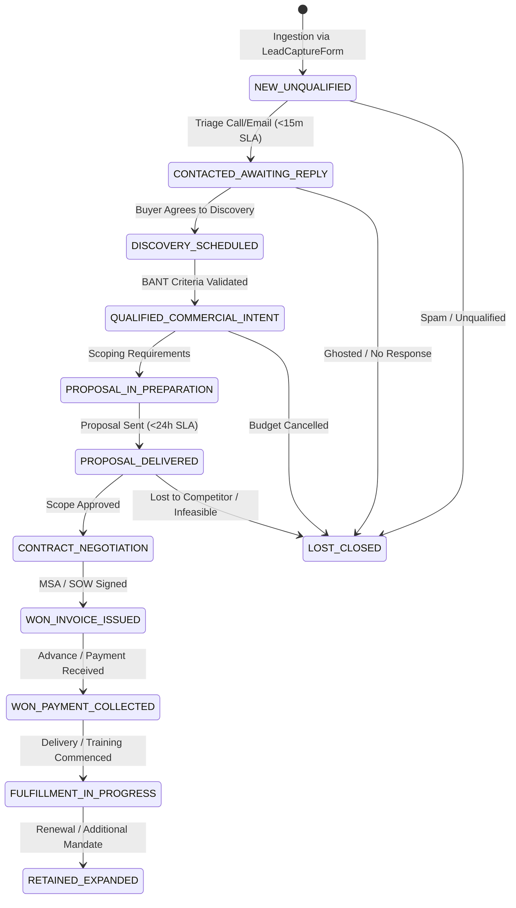

# LEAD MANAGEMENT & REVENUE OPERATIONS MANUAL

**Entity:** TalentXcel Services Private Limited (CIN: U85500UP2024PTC206390)  
**Corporate Office:** Office 1917, 19th Floor, E-Square Building, Sector 96, Noida, UP 201301  
**System Architecture:** `src/services/revenueOperations.ts` & `src/pages/RevenuePortal.tsx`  
**Access Routes:** https://talentxcel.co.in/admin | https://talentxcel.co.in/revenue-portal  
**Publication Date:** November 2026  
**Author:** Chief Growth Officer & Revenue Operations Systems Architect  

---

## 1. Executive Purpose & RevOps Philosophy

Revenue Operations (RevOps) at TalentXcel is the operational discipline that aligns marketing, sales, customer fulfillment, and finance across a single source of truth.

In high-growth corporate services, leads frequently leak through fragmented inboxes, unassigned emails, delayed follow-ups, and untracked proposals. This manual documents the **zero-loss lead management architecture** deployed within the TalentXcel codebase, detailing the 12-stage commercial lifecycle, Service Level Agreements (SLAs), local-first resilience, and the executive management portal.

---

## 2. The 12-Stage Commercial Lead Lifecycle

Every commercial inquiry captured across `talentxcel.co.in` enters a rigorous, stateful lifecycle governed by strict progression rules:



### Detailed Stage Definitions & Weighted Probability

| Stage ID | Status Name | Commercial Meaning | Weighted Win Probability | SLA / Target Duration |
| :--- | :--- | :--- | :--- | :--- |
| **01** | `NEW_UNQUALIFIED` | Lead captured via web form; awaiting initial review and de-duplication. | 5% | Max 15 minutes |
| **02** | `CONTACTED_AWAITING_REPLY` | Initial phone call or email dispatched; awaiting buyer response. | 15% | Max 48 hours |
| **03** | `DISCOVERY_SCHEDULED` | Formal 30-minute discovery call confirmed with corporate decision-maker. | 25% | Max 3 business days |
| **04** | `QUALIFIED_COMMERCIAL_INTENT` | BANT criteria validated: Budget, Authority, Need, and Timeline confirmed. | 40% | Max 24 hours |
| **05** | `PROPOSAL_IN_PREPARATION` | Custom solution scope, cohort dates, or candidate rate card being drafted. | 50% | Max 24 hours |
| **06** | `PROPOSAL_DELIVERED` | Formal commercial proposal and master agreement delivered to buyer. | 65% | Max 5 business days |
| **07** | `CONTRACT_NEGOTIATION` | Legal, commercial redlines, or SLA terms under negotiation. | 80% | Max 7 business days |
| **08** | `WON_INVOICE_ISSUED` | Agreement formally executed; initial commercial invoice or PO issued. | 95% | Max 3 business days |
| **09** | `WON_PAYMENT_COLLECTED` | Advance or milestone payment confirmed in corporate bank account. | 100% | Milestone reached |
| **10** | `FULFILLMENT_IN_PROGRESS` | Training cohort active, candidate joined, or consulting sprint in flight. | 100% | Ongoing delivery |
| **11** | `RETAINED_EXPANDED` | Client signs second cohort, additional staffing mandate, or annual retainer. | 100% | Long-term account |
| **12** | `LOST_CLOSED` | Opportunity terminated due to budget cancellation, timing, or competitor. | 0% | Closed file with reason |

---

## 3. SLA Matrix & Operational Governance

Speed-to-lead is the single highest predictor of B2B deal conversion. TalentXcel enforces non-negotiable operational SLAs:

```
+-------------------------------------------------------------+
|                TALENTXCEL REVOPS SLA BENCHMARK              |
+-------------------------------------------------------------+
| 1. FIRST TOUCH SLA:         < 15 Minutes (Business Hours)   |
| 2. DISCOVERY CALL:          < 24 Hours from Qualification   |
| 3. PROPOSAL DELIVERY:       < 24 Hours Post-Discovery       |
| 4. REPLACEMENT MANDATE:     < 72 Hours for Staffing Drops   |
+-------------------------------------------------------------+
```

### Escalation Protocol:
- If a lead remains in `NEW_UNQUALIFIED` for > 30 minutes, an automated alert flags the record in the Revenue Portal as **SLA BREACH**.
- If a proposal remains delivered for > 7 days without buyer contact, the lead owner must log an explicit qualification note or transition the stage.

---

## 4. Technical Architecture: Zero-Loss Resilience

The lead capture engine (`src/services/revenueOperations.ts`) is designed for 100% uptime and resilience against network failures:

1. **Local-First Persistence:**  
   Every lead is immediately encrypted and persisted to client-side `localStorage` (`tx_corporate_leads_v1`) upon user click, before any network request is initiated. Even if the user's connection drops, the submission is preserved locally.
2. **Webhook Redundancy:**  
   If configured with a webhook URL (`VITE_REVENUE_WEBHOOK_URL`), the system dispatches an asynchronous background payload to the company's enterprise endpoint without blocking the user interface.
3. **Reference Code Generation:**  
   Every submission automatically receives an immutable reference number:  
   `TX-2026-` followed by 4 uppercase alphanumeric characters (e.g., `TX-2026-K8R4`).
4. **Honeypot Anti-Spam:**  
   Hidden form fields invisible to human users trap automated web scrapers. Submissions with filled honeypot fields are silently rejected without polluting the pipeline.

---

## 5. Executive Revenue Portal Operating Manual

The Executive Revenue Portal is located at `/revenue-portal` (aliased to `/admin`).

### 5.1 Access & Authentication
- **Access Route:** `https://talentxcel.co.in/revenue-portal` or `/admin`
- **Authentication Method:** Session PIN Verification (`talentxcel2026`) stored in `sessionStorage`.
- **Security Control:** Prevents casual indexing and public viewing while providing instant operational access to executive directors without third-party login dependencies.

### 5.2 Portal Capabilities & Features
1. **Executive KPI Dashboard:** Real-time metrics displaying:
   - Total Leads Captured
   - Total Weighted Pipeline Value (INR)
   - Closed Won Revenue (INR)
   - Conversion Rate (%)
2. **Interactive Search & Category Filters:** Instant filtering by lead category (`corporate_training`, `staffing_recruitment`, `university_partnership`, `consulting_custom`), status stage, or keyword search across company name, contact person, or reference ID.
3. **Lead Management Dialog:**
   - **Stage Transition:** 1-click status dropdown updating the 12-stage lifecycle.
   - **Lead Ownership:** Assign team members (`Arshid Wani`, `Corporate Sales Team`, `Enterprise Practice Lead`).
   - **Deal Valuation:** Set estimated deal value and proposal value in INR.
   - **Next Follow-Up Date:** Schedule automated follow-up calendar alerts.
   - **Immutable Audit Trail:** Append time-stamped activity notes to track negotiations, call summaries, and client objections.
4. **1-Click CSV Export:**
   - Exports the entire lead database formatted for ingestion into Salesforce, HubSpot, Zoho CRM, or Microsoft Excel with all metadata, UTM parameters, and historical activity logs preserved.
