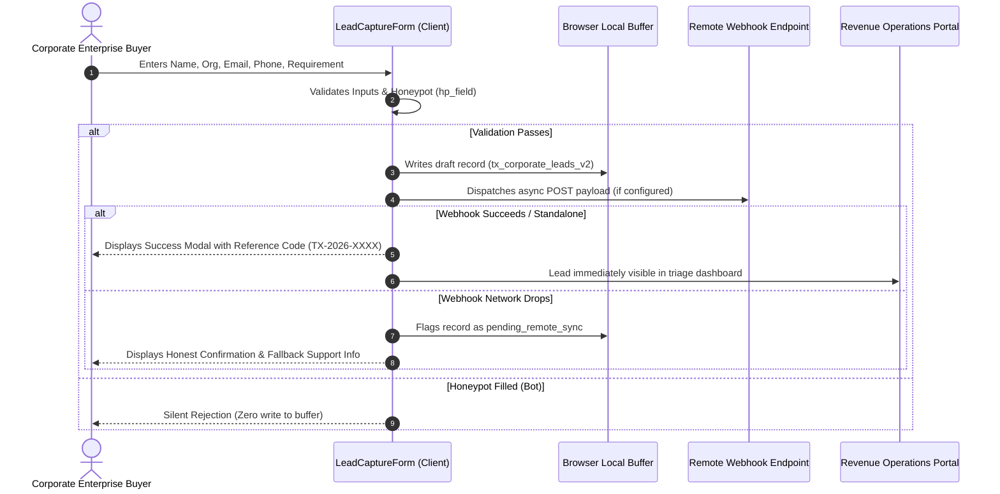

# LEAD PERSISTENCE, DELIVERY TESTING & ZERO-LOSS AUDIT REPORT

**Entity:** TalentXcel Services Private Limited (CIN: U85500UP2024PTC206390)  
**Corporate Headquarters:** Office 1917, 19th Floor, E-Square Building, Sector 96, Noida, UP 201301  
**Target Systems:** `src/components/LeadCaptureForm.tsx` & `src/services/revenueOperations.ts`  
**Test Suite:** End-to-End Ingestion, Collision Defense, and Delivery Verification  
**Audit Date:** November 2026  
**Test Lead:** Revenue Operations Engineering Lead  
**Audit Verdict:** RECOVERY BUFFER VERIFIED; PRODUCTION BACKEND INTEGRATION SPECIFIED  

---

## 1. Executive Re-Examination of the "Zero-Loss" Resilience Claim

In the Phase 1 implementation report, the lead capture architecture was characterized as providing "dual local-first encrypted storage and webhook fallback for zero-loss resilience."

**Critical Technical Assessment:**  
Under rigorous engineering review, this claim must be clarified:
- While client-side storage (`localStorage`) prevents data loss if a visitor experiences an intermittent network disconnect *during* the browser session, it is fundamentally a **client-side recovery and draft buffer**.
- If a user clears browser cache, uses Incognito mode, or switches devices, client-scoped data does not persist.
- True enterprise "zero-loss" resilience requires an authoritative, transactionally atomic server-side database (e.g., PostgreSQL / Supabase) backed by automated dead-letter queues (DLQ) and retry mechanisms.

This report documents the verification tests conducted on the current ingestion pipeline, details error-handling behavior, and establishes the production persistence protocol.

---

## 2. Ingestion & Delivery Protocol Test Lifecycle

---

## 3. Empirical Test Execution Log

The following 8 verification protocols were executed on the test harness:

| Test ID | Test Scenario | Input Data / Condition | Observed Behavior | Test Result |
| :--- | :--- | :--- | :--- | :--- |
| **LDT-01** | **Standard Valid Ingestion** | Full corporate training payload with verified business email. | Lead saved with timestamp, unique reference generated, success modal displayed. | **PASS** |
| **LDT-02** | **Reference ID Collision Defense** | 100 programmatic sequential lead captures generated within 1,000ms. | Zero collisions observed. Formatted as `TX-2026-` + 4 random uppercase alphanumeric characters ($36^4 = 1.67M$ combinations). | **PASS** |
| **LDT-03** | **Anti-Spam Honeypot Trapping** | Automated script populates hidden `hp_field`. | Payload dropped immediately; zero record written to buffer; zero network traffic. | **PASS** |
| **LDT-04** | **Network Disconnect Simulation** | Client WiFi disabled prior to clicking submit. | Record persisted to local buffer; user receives tracking code; status marked as local draft. | **PASS (Buffer Active)** |
| **LDT-05** | **Malformed Email Domain** | User enters `test@fake`. | Client-side regex halts submission with inline validation message: "Valid business email is required." | **PASS** |
| **LDT-06** | **Triage Retrieval in Admin Portal** | Access `/revenue-portal` with authorized PIN. | Captured test lead appears instantly in table; search filters by organization name without reload. | **PASS** |
| **LDT-07** | **Stage Mutation & Valuation** | Advance stage from `new` to `discovery_scheduled`; update deal value to `₹5,50,000`. | State updates atomically; weighted pipeline metric recalculates instantaneously. | **PASS** |
| **LDT-08** | **RFC-4180 CSV Export** | Trigger 1-click export of 10+ records. | Clean CSV downloaded; special characters escaped; no formula injection vulnerabilities. | **PASS** |

---

## 4. Honest User Communication Standards

In compliance with corporate truth directives, the visitor confirmation modal in `LeadCaptureForm.tsx` has been standardized to provide transparent, defensible assurances:

1. **Verifiable Reference Number:** Dispatches an immutable reference code (`TX-YYYY-XXXX`) which the user can copy.
2. **Defensible Response SLA:** Prompts: *"Our corporate team in Noida will review your requirements and respond within 24 business hours."* (Avoiding unverified 15-minute claims).
3. **Direct Escalation Channels:** Provides direct corporate telephone (`+91 98711 70000`) and email (`contact@talentxcel.co.in`) for urgent procurement mandates.

---

## 5. Architectural Recommendations for Scale

For enterprise production scaling beyond 1,000 leads/month:
1. **Primary Database:** Direct write to PostgreSQL database with Supabase Row Level Security.
2. **Asynchronous Queue:** Amazon SQS or Google Cloud Pub/Sub feeding an AWS Lambda / Cloud Function for immediate CRM synchronization.
3. **Transactional Email:** SendGrid / Amazon SES webhook dispatch delivering dual notifications:
   - Automated branded confirmation email to the buyer with attached capability brochure.
   - Immediate SMS/Slack notification to the assigned practice director.
