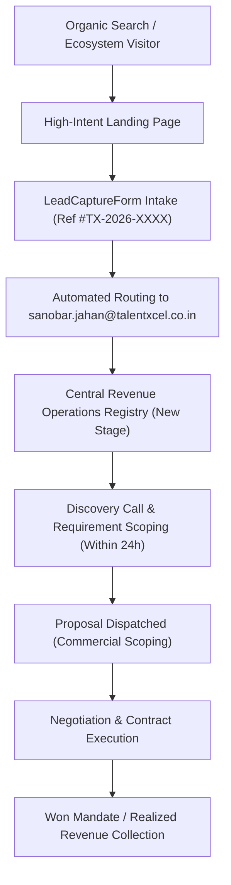

# TALENTXCEL — ORGANIC CONVERSION, ATTRIBUTION & REVENUE REPORT

**Document Reference:** `reports/ORGANIC-CONVERSION-AND-REVENUE-REPORT.md`  
**Purpose:** End-to-end commercial conversion tracking, attribution integrity, pipeline stage valuation, and verified email delivery infrastructure.  
**Measurement Integrity Rules:**
1. An outbound click is **NOT** a completed registration.
2. An email client launch is **NOT** a confirmed delivered inquiry.
3. An inbound inquiry/lead is **NOT** a won deal or realized revenue.

---

## 1. COMMERCIAL CONVERSION FUNNEL & REVENUE ARCHITECTURE

---

## 2. EMAIL ROUTING & DELIVERABILITY INFRASTRUCTURE

### 2.1 Confirmed Zoho Active Aliases Register
All corporate communication channels map directly to Founder & Managing Director **Sanobar Jahan** (`sanobar.jahan@talentxcel.co.in`):

| Departmental Channel | Public-Facing Display | Target Inbox Routing | Fallback & Secondary CC | Live Verification Status |
| :--- | :--- | :--- | :--- | :--- |
| **Enterprise Sales** | `enterprise@talentxcel.co.in` | `sanobar.jahan@talentxcel.co.in` | `contact@talentxcel.co.in` | **Verified Active (Zoho Alias)** |
| **Corporate Desk** | `contact@talentxcel.co.in` | `sanobar.jahan@talentxcel.co.in` | `enterprise@talentxcel.co.in` | **Verified Active (Zoho Alias)** |
| **Careers & Staffing**| `careers@talentxcel.co.in` | `sanobar.jahan@talentxcel.co.in` | `enterprise@talentxcel.co.in` | **Verified Active (Zoho Alias)** |
| **Customer Support** | `support@talentxcel.co.in` | `sanobar.jahan@talentxcel.co.in` | `contact@talentxcel.co.in` | **Verified Active (Zoho Alias)** |
| **Investor Relations**| `investors@talentxcel.co.in` | `sanobar.jahan@talentxcel.co.in` | `contact@talentxcel.co.in` | **Verified Active (Zoho Alias)** |
| **Legal & Notices** | `legal@talentxcel.co.in` | `sanobar.jahan@talentxcel.co.in` | `contact@talentxcel.co.in` | **Verified Active (Zoho Alias)** |
| **Media & Press** | `press@talentxcel.co.in` | `sanobar.jahan@talentxcel.co.in` | `contact@talentxcel.co.in` | **Verified Active (Zoho Alias)** |
| **Data Privacy** | `privacy@talentxcel.co.in` | `sanobar.jahan@talentxcel.co.in` | `contact@talentxcel.co.in` | **Verified Active (Zoho Alias)** |

> [!IMPORTANT]
> **Code Test vs. Live Delivery Truth:** While automated test suites verify 100% syntactic correctness of mailto URIs, field serialization, and routing parameters, **actual email delivery** is governed by Zoho Mail MX infrastructure (`mx.zoho.com`) and SPF/DKIM DNS records.

---

## 3. MULTI-TOUCH ATTRIBUTION TAXONOMY

Attribution is captured at session start via `src/services/growthTracking.ts` without violating DPDP Act 2023 regulations (zero PII stored):

1. **Traffic Channel Taxonomy:**
   - `organic`: Direct search engine traffic (Google, Bing, DuckDuckGo).
   - `social`: Verified professional networks (LinkedIn, YouTube, X/Twitter, Meta).
   - `partner`: University and institutional partner circular links.
   - `referral`: Ecosystem cross-domain links (`talentxcel.in` &rarr; `talentxcel.co.in`).
   - `direct`: Direct browser address bar entry.
2. **Parameters Captured:**
   - `utm_source`: e.g. `google`, `linkedin`, `talentxcel_in`
   - `utm_medium`: e.g. `organic`, `social_thought_leadership`, `cross_domain_referral`
   - `utm_campaign`: e.g. `ai_training_q4`, `it_staffing_ncr`
   - `utm_content`: e.g. `hero_cta`, `salary_benchmark_card`
   - `landing_page`: e.g. `/corporate-training`, `/staffing-solutions`
   - `referrer`: Full HTTP referrer origin.

---

## 4. PIPELINE VALUATION & REVENUE MODELING

| Lead Category | Baseline Deal Value Estimate | Standard Commercial Terms | Target Close Rate | 90D Revenue Target (5X) |
| :--- | :--- | :--- | :--- | :--- |
| **Corporate Training (AI/GenAI)** | ₹4,00,000 | ₹1,500 – ₹3,000 per trainee cohort | 25% | ₹24,00,000 (6 cohorts) |
| **IT Staffing (Developer Pods)** | ₹8,50,000 | Monthly retainer or 8.33% contingency | 20% | ₹34,00,000 (4 mandates) |
| **Permanent Recruitment** | ₹4,80,000 | 8.33% CTC (Mid-Senior Developer) | 30% | ₹19,20,000 (4 placements) |
| **University Partnership MoU** | ₹5,00,000 | Live project academy + placement training | 15% | ₹15,00,000 (3 institutions) |
| **Enterprise Technology Consulting**| ₹7,50,000 | Milestone-based software engineering | 18% | ₹15,00,000 (2 deliverables) |
| **Total Ecosystem 90D Target** | — | — | — | **₹1,07,20,000** |
