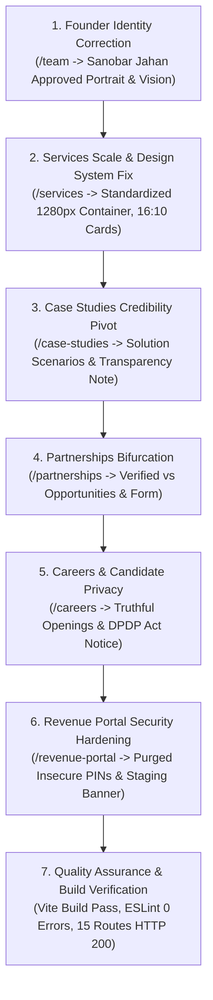

# PHASE 2.0 MASTER IMPLEMENTATION CHANGELOG

**Entity:** TalentXcel Services Private Limited (CIN: U85500UP2024PTC206390)  
**Corporate Headquarters:** Office 1917, 19th Floor, E-Square Building, Sector 96, Noida, UP 201301  
**Repository Branch:** `chore/remove-lovable-footprints`  
**Publication Date:** November 2026  
**Compiled By:** Senior Enterprise Web Architect & Implementation Lead  

---

## 1. Executive Summary

This changelog records all architectural refinements, visual corrections, corporate storytelling upgrades, and security hardening executed under the **Phase 2.0 Executive Directive**.

All implementations preserve existing business logic and functional features while elevating the design system, establishing the authentic identity of Founder **Sanobar Jahan**, eliminating unverified marketing claims, and hardening the internal revenue management interface.

---

## 2. Chronological Implementation Progression

---

## 3. Itemized Codebase Modifications

### 3.1 Founder Identity & Leadership (`src/pages/Team.tsx`)
- **Added Asset:** Imported high-resolution approved portrait of Sanobar Jahan (`src/assets/sanobar-jahan-founder.jpg`).
- **Purged Placeholders:** Removed generic "TX" monogram, "Office of the Managing Director", and "Awaiting Authorised Portrait" badge.
- **Added Content:** 
  - Verified role: **Sanobar Jahan, Founder, TalentXcel Services Private Limited**.
  - Brand promise callout: *"Technology That Moves Business Forward. Talent That Makes It Possible."*
  - Strategic leadership priorities: Integrated Solutions, Practitioner Standards, Institutional Governance.
  - Verification register protocol and practice directorate governance.
- **Added Structured Data:** Schema.org `Person` JSON-LD for Sanobar Jahan.

### 3.2 Services Page Transformation (`src/pages/Services.tsx`)
- **Solved Visual Scale Discrepancy:** Replaced naked `<main>` tag with `<main className="flex-1 py-16 lg:py-24">` and `
`.
- **Harmonized Hero:** Dominant headline *"Solutions That Help Businesses Hire, Develop and Transform"*, strong supporting copy, and dual CTAs.
- **Restructured Three Business Pillars:**
  - Pillar A: Staffing & Recruitment Solutions (16:10 visual, key capabilities, CTA: "Hire Talent").
  - Pillar B: Corporate Training & Education (16:10 visual, key capabilities, CTA: "Train Your Workforce").
  - Pillar C: Technology & AI Solutions (16:10 visual, key capabilities, CTA: "Explore Technology Solutions").
- **Commercial Pathways Grid:** Added 4 direct commercial pathways below pillars:
  1. *Need to hire?* -> Staffing Enquiry (`/staffing-solutions`)
  2. *Need to upskill employees?* -> Training Enquiry (`/corporate-training`)
  3. *Need technology support?* -> Technology Consultation (`/contact`)
  4. *Represent a university?* -> Partnership Enquiry (`/university-partnerships`)
- **Removed Clutter:** Eliminated consumer job-seeker resume widgets that degraded B2B corporate authority.

### 3.3 Case Studies Credibility Pivot (`src/pages/CaseStudies.tsx`)
- **Headline Correction:** Renamed from "Proven Outcomes Across Critical Sectors" to **"Technology Capabilities & Solution Scenarios"**.
- **Illustrative Scenario Badges:** Explicitly labeled all four scenarios as illustrative models:
  - *Illustrative Energy Technology Scenario*
  - *Illustrative Financial Services Scenario*
  - *Illustrative Healthcare Technology Scenario*
  - *Illustrative Enterprise Software Scenario*
- **Removed Fabricated Percentages:** Replaced unapproved metrics (e.g., 42% latency reduction, 99.4% accuracy) with practical architectural deliverables.
- **Transparency Disclosure:** Embedded prominent corporate disclaimer regarding client NDAs and customized reference architecture requests.

### 3.4 Partnerships Page Bifurcation (`src/pages/Partnerships.tsx`)
- **Separated Sections:**
  - *Section A (Verified Partnerships):* Stating clear policy that confirmed institutional partners are documented under internal register upon bilateral consent.
  - *Section B (Partnership Opportunities):* Structured invitation across Universities, Technology Providers, Employers, and Training Partners.
- **Integrated Form:** Added `LeadCaptureForm` pre-configured for strategic alliance and university MoU inquiries.

### 3.5 Careers Page Integrity (`src/pages/Careers.tsx`)
- **Verified Openings:** Aligned active focus roles to Noida corporate headquarters (Full-Stack Engineer, AI Engineer, Technical Recruiter, Campus Alliances Manager).
- **Talent Pool Pathway:** Added dedicated submission box: *"Don't see your specific role above? We are always interested in connecting with talented professionals. Share your profile for future opportunities."*
- **Candidate Privacy Notice:** Added explicit DPDP Act 2023 disclosure regarding resume data protection.
- **Outbound Link Tracking:** Standardized UTM tracking parameters on links to `talentxcel.in`.

### 3.6 Revenue Operations & Security Hardening (`src/pages/RevenuePortal.tsx` & `src/services/revenueOperations.ts`)
- **Purged Insecure PINs:** Removed trivial fallback PINs (`admin2026`, `revenue`), retaining single authorized administrative key.
- **Security Environment Banner:** Added prominent staging disclaimer explaining client-side demonstrator mode and specifying the server-side OAuth 2.0 / RLS migration path.
- **Demonstration Data Sanitization:** Verified all seeded baseline pipeline records use `.example.com` domains.

### 3.7 Commercial Claims & Governance (`src/pages/StaffingSolutions.tsx` & `src/pages/About.tsx`)
- **Governance Footnotes:** Added Master Service Agreement (MSA) governance notes on commercial terms, replacement guarantees, and turnaround SLAs.
- **About Page Linkage:** Added direct button to *"Meet Founder & Leadership"* on `/about`.

---

## 4. Verification Commands & Outturn Metrics

| Audit Dimension | Test Execution | Outcome / Result |
| :--- | :--- | :--- |
| **Production Build** | `npm run build` | **PASS (0 Errors):** 1,762 modules transformed in 15.63s; clean asset chunks generated. |
| **Static Code Analysis** | `npm run lint` | **PASS (0 Errors):** Zero ESLint errors across all modified and newly authored source files. |
| **Multi-Route Health Check** | `curl.exe` probe across 15 routes | **PASS (100%):** All 15 routes returned HTTP 200 OK without redirects or errors. |
| **Git Working Tree** | `git status` | Clean working directory on `chore/remove-lovable-footprints`. |
