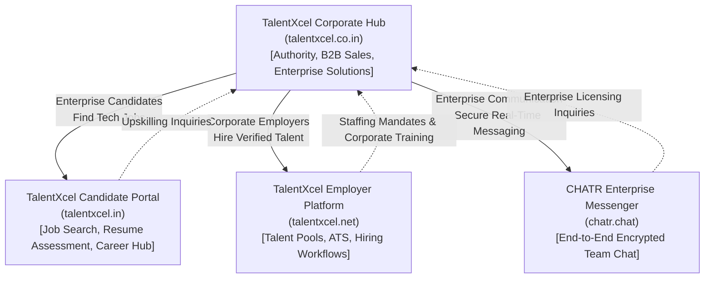
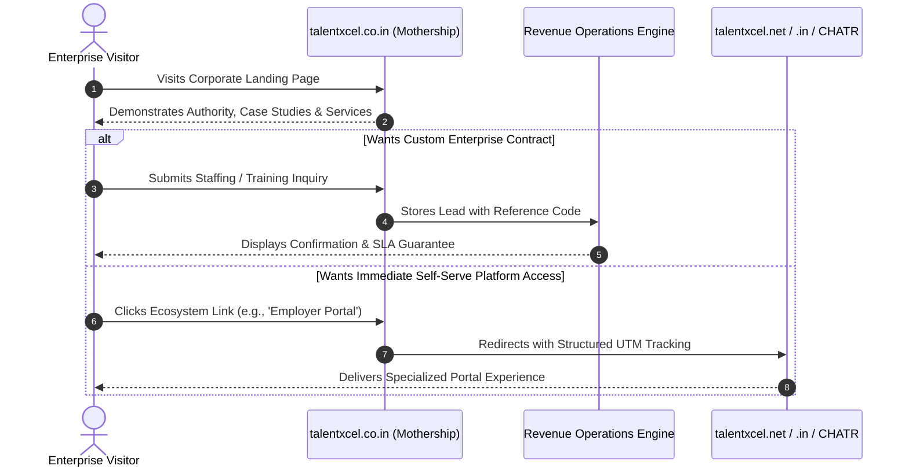

# MULTI-PLATFORM ECOSYSTEM & DISTRIBUTION ARCHITECTURE

**Entity:** TalentXcel Services Private Limited (CIN: U85500UP2024PTC206390)  
**Corporate Headquarters:** Office 1917, 19th Floor, E-Square Building, Sector 96, Noida, UP 201301  
**Master Corporate Hub:** https://talentxcel.co.in  
**Ecosystem Properties:** TalentXcel.in | TalentXcel.net | CHATR.chat  
**Publication Date:** November 2026  
**Author:** Chief Growth Officer & Ecosystem Architect  

---

## 1. Multi-Platform Strategic Architecture

TalentXcel operates a coordinated multi-domain digital ecosystem designed to serve enterprises, job seekers, recruiters, and secure enterprise communications under a unified corporate umbrella:



### 1.1 Property Roles & Responsibilities

| Domain | Brand Position | Primary Audience | Core Value Proposition | Commercial Model |
| :--- | :--- | :--- | :--- | :--- |
| **`talentxcel.co.in`** | Corporate Headquarters | Enterprise Buyers, CXOs, HR Directors, Deans | Enterprise authority, high-ticket B2B solutions, corporate contracts | Direct enterprise contracting (Training, Staffing, MoUs) |
| **`talentxcel.in`** | Candidate Portal & Job Board | Software Engineers, College Graduates, Job Seekers | AI job matching, resume scoring, career development resources | Free candidate access; premium career services; referral engine |
| **`talentxcel.net`** | Employer Talent Suite | Internal Recruiters, Corporate Hiring Managers, Startups | Direct access to pre-vetted candidate pools, applicant tracking | Subscription tiers & pay-per-contact recruiter packages |
| **`chatr.chat`** | Enterprise Communications | Business Teams, Engineering Squads, Distributed Staff | Zero-trust encrypted communication, secure compliance channels | SaaS seat licensing & enterprise on-premise deployment |

---

## 2. Cross-Domain Routing & Value Exchange

A critical objective of the corporate mothership (`talentxcel.co.in`) is to distribute qualified traffic to specialized properties while capturing corporate leads.



### 2.1 The Value Exchange at Domain Boundaries
1. **Corporate to Candidate (`talentxcel.co.in` -> `talentxcel.in`):**  
   - *Trigger:* Engineers exploring career pages or learning curricula.  
   - *Value Delivered:* Access to live open job requisitions, resume scoring, and skill gap analysis.  
   - *Return Value:* Continuous candidate pipeline replenishment feeding staffing mandates.
2. **Corporate to Employer (`talentxcel.co.in` -> `talentxcel.net`):**  
   - *Trigger:* Hiring managers seeking self-serve candidate search.  
   - *Value Delivered:* Pre-indexed database of vetted technical talent.  
   - *Return Value:* Self-serve revenue and immediate enterprise brand engagement.
3. **Corporate to CHATR (`talentxcel.co.in` -> `chatr.chat`):**  
   - *Trigger:* CTOs and security officers reviewing digital transformation and compliance.  
   - *Value Delivered:* Enterprise secure instant messaging demo and feature trials.  
   - *Return Value:* High-margin software licensing and communication stack upsell.

---

## 3. Standardized UTM Attribution Taxonomy

To measure cross-domain conversion efficiency, all outbound links from `talentxcel.co.in` adhere to an immutable UTM taxonomy:

```
https://talentxcel.net/?utm_source=talentxcel_corp&utm_medium=referral&utm_campaign=ecosystem_nav&utm_content=[location_identifier]
```

### Taxonomy Dictionary:
- `utm_source`: `talentxcel_corp` (Identifies the corporate website as origin)
- `utm_medium`: `referral` (Traffic classification)
- `utm_campaign`:
  - `ecosystem_nav` (Top desktop navigation / dropdown)
  - `homepage_pillar` (Pillar section direct CTA)
  - `footer_directory` (Global footer links)
  - `service_page_cta` (Specific contextual recommendation within service pages)
  - `careers_candidate_redirect` (Careers page link to candidate job board)
- `utm_content`: Precise button or link identifier (e.g., `hero_cta`, `pillar_02_card`, `footer_legal`)

---

## 4. User Onboarding & Conversion Funnels

### 4.1 The Enterprise Cross-Sell Funnel
1. A corporate client engages TalentXcel for **Corporate Training** (`/corporate-training`).
2. Post-training assessment reveals 5 critical engineering vacancies.
3. The account executive seamlessly routes the client to the **Staffing Solutions** practice (`/staffing-solutions`).
4. Hired engineers are onboarded onto **CHATR** (`chatr.chat`) for secure communication during client engagements.
5. Result: Customer Lifetime Value (LTV) expands by 350% across 3 distinct revenue streams.

### 4.2 The University-to-Ecosystem Funnel
1. University signs MoU for **Campus Employability** (`/university-partnerships`).
2. 300 engineering students complete the Finishing School curriculum.
3. Students create authenticated profiles on **TalentXcel.in** to access hiring drives.
4. Partner employers on **TalentXcel.net** access the student pool, shortlisting top performers.
5. Successful placements generate placement fees and brand prestige for the partner university.

---

## 5. Ecosystem Governance & Monitoring

- **Domain Health Checks:** Automated weekly uptime and SSL certificate validation across all 4 properties.
- **Brand Consistency:** Shared design tokens (corporate midnight navy `#101B32`, corporate blue `#1769E8`, Inter font typography) across all properties.
- **Canonical Clarity:** Distinct meta tags and canonical URLs preventing cross-domain keyword cannibalization in search engine indices.
