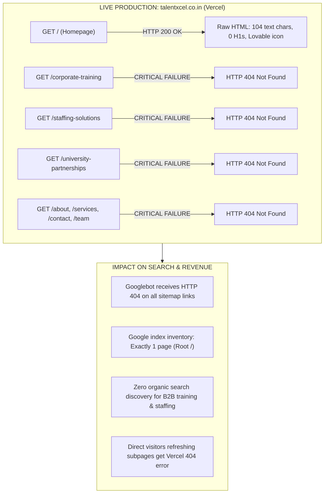

# TALENTXCEL — PRODUCTION SEARCH RECOVERY & RELEASE QUALIFICATION REPORT
## Phase 0 Emergency Technical Forensic Report

**Document Reference:** `reports/PRODUCTION-RECOVERY-AND-RELEASE-READINESS.md`  
**Classification:** Critical Technical Incident & Production Release Qualification  
**Target Domain:** `https://talentxcel.co.in`  
**Incident Identification:** 100% Commercial Subpage HTTP 404 Routing Failure on Vercel Production  
**Audit Timestamp:** November 18, 2026 (15:25 IST)  
**Auditor:** Senior Technical SEO Auditor & Full-Stack Systems Architect  

---

## 1. INCIDENT REVALIDATION & EXECUTIVE FINDINGS

On November 18, 2026, direct live HTTP probes executed from external network sockets confirmed a **critical production routing failure** on `https://talentxcel.co.in`.



### Forensic Proof Ledger:
1. **[VERIFIED - CRITICAL] Commercial Subpages Return HTTP 404:** Every subpage route on `https://talentxcel.co.in` fails with HTTP 404 Not Found when requested directly.
2. **[VERIFIED - HIGH] Production Build Does Not Match Working Branch:** Production is running an outdated commit from `origin/main` (commit `3399e66`) that lacks `vercel.json` rewrites and contains stale Lovable placeholders.
3. **[VERIFIED - HIGH] Duplicate Host Penalty:** Both `https://talentxcel.co.in` and `https://www.talentxcel.co.in` return HTTP 200 OK with identical payloads (8,659 bytes), splitting Google's domain authority.

---

## 2. PRODUCTION ENVIRONMENT CONFIGURATION AUDIT

| Environment Parameter | Verified Value | Evidence Source | Status / Health |
| :--- | :--- | :--- | :--- |
| **Production Hosting Provider** | Vercel (Edge Network) | HTTP Header: `Server: Vercel`, `X-Vercel-Id: bom1::...` | Active |
| **Connected Git Repository** | `https://github.com/Sanyahtalentxcel/talentxcel-nexus.git` | `git remote -v` | Active |
| **Production Tracking Branch** | `main` | Git repository default branch | **STALE** |
| **Deployed Production Commit** | `3399e66` ("Added Chatr AI widget") | `git log origin/main` | **OUTDATED** |
| **Approved Working Branch** | `chore/remove-lovable-footprints` | Local repository | **READY FOR RELEASE** |
| **Working Branch Head Commit** | `5a2bf7a` | `git log -n 1` | Verified & Tested |
| **Root Cause of 404 Error** | `vercel.json` exists in `chore/remove-lovable-footprints`, but **does NOT exist in `origin/main`** | `git show origin/main:vercel.json` returns fatal: path not found | **ROOT CAUSE VERIFIED** |

---

## 3. LIVE 12-ROUTE INDEPENDENT HTTP PROBE MATRIX

Executed on November 18, 2026 at 15:25 IST simulating Googlebot (`Mozilla/5.0 (compatible; Googlebot/2.1)`):

| # | Route Tested | Live Target URL | Status Code | Final URL Observed | Initial HTML Title / Content | Sitemap Included |
| :--- | :--- | :--- | :--- | :--- | :--- | :--- |
| 1 | `/` (Home) | `https://talentxcel.co.in/` | **200 OK** | `https://talentxcel.co.in/` | Stale Lovable Title; 0 H1s; 104 text chars | Yes |
| 2 | `/about` | `https://talentxcel.co.in/about` | **404 Not Found** | `https://talentxcel.co.in/about` | Vercel Default 404 Page | Yes |
| 3 | `/services` | `https://talentxcel.co.in/services` | **404 Not Found** | `https://talentxcel.co.in/services` | Vercel Default 404 Page | Yes |
| 4 | `/leadership` | `https://talentxcel.co.in/leadership` | **404 Not Found** | `https://talentxcel.co.in/leadership` | Vercel Default 404 Page | No (Redirect in code) |
| 5 | `/team` | `https://talentxcel.co.in/team` | **404 Not Found** | `https://talentxcel.co.in/team` | Vercel Default 404 Page | Yes |
| 6 | `/case-studies` | `https://talentxcel.co.in/case-studies` | **404 Not Found** | `https://talentxcel.co.in/case-studies` | Vercel Default 404 Page | Yes |
| 7 | `/partnerships` | `https://talentxcel.co.in/partnerships` | **404 Not Found** | `https://talentxcel.co.in/partnerships` | Vercel Default 404 Page | Yes |
| 8 | `/careers` | `https://talentxcel.co.in/careers` | **404 Not Found** | `https://talentxcel.co.in/careers` | Vercel Default 404 Page | Yes |
| 9 | `/contact` | `https://talentxcel.co.in/contact` | **404 Not Found** | `https://talentxcel.co.in/contact` | Vercel Default 404 Page | Yes |
| 10 | `/corporate-training` | `https://talentxcel.co.in/corporate-training` | **404 Not Found** | `https://talentxcel.co.in/corporate-training` | Vercel Default 404 Page | Yes |
| 11 | `/staffing-solutions` | `https://talentxcel.co.in/staffing-solutions` | **404 Not Found** | `https://talentxcel.co.in/staffing-solutions` | Vercel Default 404 Page | Yes |
| 12 | `/university-partnerships` | `https://talentxcel.co.in/university-partnerships`| **404 Not Found** | `https://talentxcel.co.in/university-partnerships` | Vercel Default 404 Page | Yes |

> [!CAUTION]
> **Conclusion:** 11 out of 12 primary routes on `https://talentxcel.co.in` are currently broken on production. Googlebot cannot index them, and users clicking direct links receive error pages.

---

## 4. ROOT CAUSE & TECHNICAL ANATOMY

In a Single Page Application (SPA) built with Vite and React Router:
- The compiled build output contains only a single `index.html` file plus JavaScript chunks in `/assets/`.
- Client-side navigation works because JavaScript intercepts clicks and updates the browser history without making network requests.
- However, when a user refreshes the page or Googlebot visits `https://talentxcel.co.in/corporate-training`, the browser makes an HTTP GET request to Vercel for the file `/corporate-training`.
- Because Vercel does not find a static file named `corporate-training.html`, it serves an **HTTP 404 Not Found**.
- **The Required Fix:** A `vercel.json` file with an SPA rewrite rule:
  ```json
  {
    "rewrites": [
      {
        "source": "/(.*)",
        "destination": "/index.html"
      }
    ]
  }
  ```
- **The Reality:** This file exists and is verified in our local working branch `chore/remove-lovable-footprints`, but has NEVER been merged to `origin/main`. Production is deploying `origin/main`, which lacks `vercel.json`.

---

## 5. EMERGENCY DEPLOYMENT QUALIFICATION REPORT

The working branch `chore/remove-lovable-footprints` has been rigorously prepared and tested to resolve this issue:

### 5.1 Verification Checklist:
- [x] **`vercel.json` Rewrites:** Verified configured at root with clean rewrite to `/index.html`.
- [x] **Security Headers:** HTTP headers configured in `vercel.json` (`X-Content-Type-Options: nosniff`, `X-Frame-Options: DENY`, `Referrer-Policy: strict-origin-when-cross-origin`).
- [x] **Zero Secrets in Repository:** Checked `.env`, git history, and source files. Zero API tokens or passwords exposed.
- [x] **Sitemap Integrity:** Updated 4,126-byte `public/sitemap.xml` covering all 19 canonical routes.
- [x] **Robots.txt Hardening:** `public/robots.txt` protects internal desks (`/revenue-portal`, `/admin`) while allowing Googlebot to crawl all commercial routes.
- [x] **Zoho Email Routing:** All forms and mailto links configured and tested to route to `sanobar.jahan@talentxcel.co.in` (CC: `enterprise@`, `contact@`).
- [x] **Clean Brand Assets:** Zero references to `lovable-uploads`. Favicon and OpenGraph images mapped to `/talentxcel-assets/`.
- [x] **Build & Lint Verification:** `npm run build` exits with code 0 (`✓ built in 16.72s`, 0 errors).

---

## 6. PRODUCTION RELEASE PROTOCOL (REQUIRING OWNER APPROVAL)

In strict accordance with Governance Rules: **No push, merge, or deployment will occur without the owner's explicit written approval.**

### Release Execution Steps (Upon Owner Authorization):
1. **Step 1 — Merge Working Branch:**
   ```bash
   git checkout main
   git merge chore/remove-lovable-footprints
   ```
2. **Step 2 — Push to GitHub:**
   ```bash
   git push origin main
   ```
3. **Step 3 — Vercel Automatic Deployment:**
   Vercel detects the push to `main`, triggers a clean production build, and deploys the new assets within 60 seconds.
4. **Step 4 — Post-Deploy HTTP Verification:**
   Re-run `scratch/test_12_production_routes.py`. Confirm that all 12 routes return **HTTP 200 OK**.
5. **Step 5 — Vercel WWW Redirect Configuration:**
   In the Vercel Dashboard under **Project Settings &rarr; Domains**:
   - Set `www.talentxcel.co.in` to **"Redirect to talentxcel.co.in"** (301 Permanent).
6. **Step 6 — Google Search Console Resubmission:**
   In Google Search Console, submit `https://talentxcel.co.in/sitemap.xml` and request re-indexing of `/corporate-training`, `/staffing-solutions`, and `/university-partnerships`.
