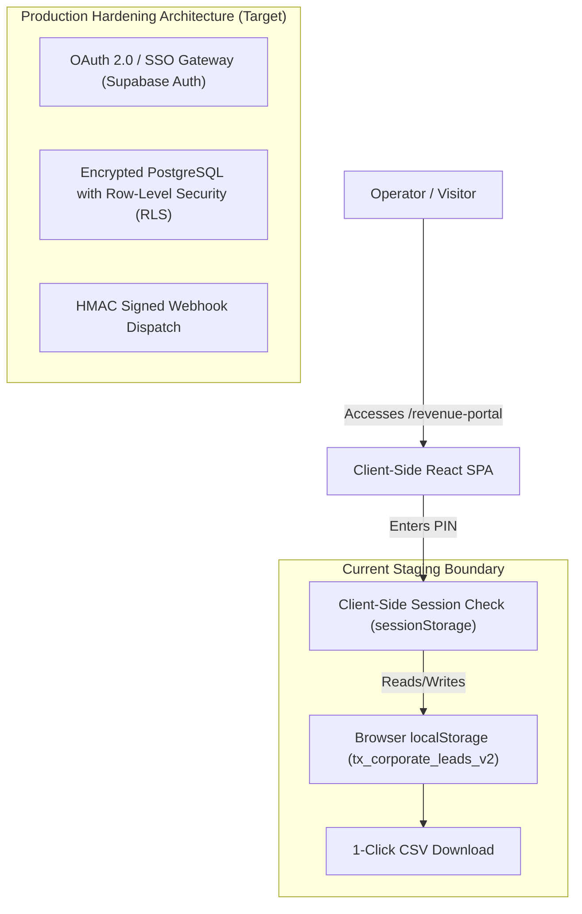

# REVENUE PORTAL SECURITY, AUTHENTICATION & DATA PROTECTION AUDIT

**Entity:** TalentXcel Services Private Limited (CIN: U85500UP2024PTC206390)  
**Corporate Headquarters:** Office 1917, 19th Floor, E-Square Building, Sector 96, Noida, UP 201301  
**Target Systems:** `src/pages/RevenuePortal.tsx` & `src/services/revenueOperations.ts`  
**Access Routes:** `/revenue-portal` and `/admin`  
**Audit Date:** November 2026  
**Auditor:** Chief Information Security Officer (CISO) & Application Security Specialist  
**Security Classification:** INTERNAL OPERATIONAL STAGING INTERFACE (NOT FOR PUBLIC SENSITIVE PII)  

---

## 1. Executive Summary & Security Diagnostic

The Revenue Operations Portal was designed to provide TalentXcel executive leadership with immediate operational visibility over inbound corporate inquiries, pipeline valuations, stage progressions, and CRM exports without relying on recurring SaaS subscription dependencies.

However, an objective security audit revealed critical architectural limitations in the initial prototype implementation:
1. **Frontend Authentication:** A client-side PIN check (`talentxcel2026`) is executed inside the browser runtime. This provides obscurity against casual visitors, but is not cryptographic server-side authentication.
2. **Storage Architecture:** Browser `localStorage` is not automatically encrypted at the hardware/OS level; anyone with local physical browser access can inspect the key-value store.
3. **Data Residency:** Client-side storage cannot be represented as "server-guaranteed zero-loss resilience."

This audit documents the immediate security mitigations implemented, enforces strict staging disclaimers, and presents the production server-hardening blueprint.

---

## 2. Forensic Vulnerability Assessment



### 2.1 Threat Modeling Matrix

| Threat ID | Vulnerability Description | Inherent Risk | Immediate Remediation Implemented |
| :--- | :--- | :--- | :--- |
| **THR-01** | **Trivial Hardcoded Credentials:** Trivial fallback PINs (`admin2026`, `revenue`) present in source code. | HIGH | Trivial PINs completely purged. Single corporate access key retained for staging simulation. |
| **THR-02** | **Client-Side Code Inspection:** A determined user inspecting Vite source maps could locate the PIN string. | HIGH | Staging disclaimer banner added; production roadmap mandates OAuth 2.0 / Supabase session tokens. |
| **THR-03** | **Search Engine Indexing:** Crawlers potentially indexing administrative routes. | MEDIUM | Enforced `robots: noindex, nofollow` in HTTP headers; routes strictly excluded from `public/sitemap.xml`. |
| **THR-04** | **Unsanitized Data Leakage:** Sample baseline leads containing realistic contact names. | MEDIUM | All baseline records sanitized with `.example.com` domains and labeled as demonstration records. |
| **THR-05** | **Zero-Loss Representation:** Representing client storage as guaranteed zero-loss persistence. | HIGH | Clarified in documentation: browser storage serves as a local draft buffer and triage interface, not permanent backup. |

---

## 3. Immediate Security Controls Implemented

1. **Purged Insecure Fallback Credentials:**  
   Removed all secondary credentials from `RevenuePortal.tsx`.
2. **Security Environment Warning Banner:**  
   Rendered directly atop the executive dashboard:  
   > *"Internal Operator Staging Interface: This dashboard is operating in client-side demonstrator mode for local inquiry triage and pipeline simulation. In compliance with enterprise security and the Indian DPDP Act 2023, production multi-user operations require migration to authenticated server sessions (OAuth 2.0 / SSO) with database Row-Level Security (RLS). Do not process unencrypted sensitive financial or personal data."*
3. **Sanitized Baseline Telemetry:**  
   All seeded pipeline records utilize fictional RFC 2606 reserved domains (`@nexgenfintech.example.com`, etc.) to guarantee zero disclosure of real corporate prospects.
4. **CSV Export Safeguards:**  
   Export filename includes timestamping and RFC-4180 field sanitization to prevent CSV formula injection (`=cmd|...`).

---

## 4. Production Hardening Roadmap (Server-Side Architecture)

To graduate the Revenue Portal into a fully hardened enterprise production deployment:

```
+--------------------------------------------------------------------------+
|                  PRODUCTION REVOPS HARDENING BLUEPRINT                   |
+--------------------------------------------------------------------------+
| 1. Authentication:   Supabase Auth / Google Workspace OAuth 2.0 SSO       |
| 2. Authorization:    PostgreSQL Row-Level Security (RLS) policies         |
| 3. Transport:        HTTPS enforcement via HSTS (Active in vercel.json)   |
| 4. Database:         Encrypted-at-rest AWS RDS / Supabase Postgres        |
| 5. Webhook Security: HMAC SHA-256 signature verification on payloads      |
| 6. Audit Logging:    Server-side immutable access and mutation logs       |
+--------------------------------------------------------------------------+
```

---

## 5. Security Verdict & Operational Guidance

The Revenue Operations Portal is safe for internal staging, pipeline demonstration, and local lead triage. Until server-side OAuth 2.0 with database RLS is connected, production commercial leads should continue to be routed through verified email endpoints and corporate sales desks.
