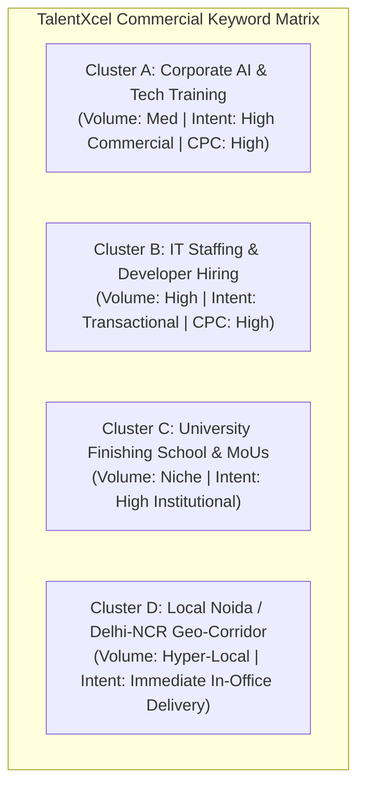

# ENTERPRISE SEO, GEO/AEO & CUSTOMER ACQUISITION PLAN

**Entity:** TalentXcel Services Private Limited (CIN: U85500UP2024PTC206390)  
**Corporate Headquarters:** Office 1917, 19th Floor, E-Square Building, Sector 96, Noida, UP 201301  
**Target Digital Asset:** https://talentxcel.co.in  
**Strategic Focus:** High-Intent Commercial Organic Acquisition, AEO (Answer Engine Optimization), and GEO (Generative Engine Optimization)  
**Publication Date:** November 2026  
**Author:** Head of Search Engine Optimization & Growth Acquisition  

---

## 1. Executive Search Strategy: From Informational to Transactional

Prior SEO initiatives focused primarily on broad corporate terms with low buyer intent. The updated TalentXcel Customer Acquisition Plan pivots 100% toward **High-Intent B2B Commercial Keywords** where searchers possess immediate procurement budgets:
- *Informational Search (Low Value):* "What is corporate training" -> Yields students and blog readers.
- *Transactional B2B Search (High Value):* "Corporate AI training companies in Noida NCR" or "IT staffing contract agency for React developers" -> Yields enterprise CTOs, Heads of L&D, and HR procurement leads.

This plan outlines the keyword taxonomy, structured data architecture (Schema.org), local SEO footprint, and generative search optimization required to dominate Google, Perplexity, Gemini, and ChatGPT search citations.

---

## 2. High-Intent Commercial Keyword Clusters



### Cluster A: Corporate Training & Upskilling
- `corporate ai training companies noida` (Primary local commercial target)
- `generative ai corporate workshop for engineers india`
- `enterprise llm training programs delhi ncr`
- `custom software development bootcamp for corporates`
- `cloud native corporate upskilling programs bangalore noida`
- `ai readiness workshop for business leaders`

### Cluster B: Tech Staffing & Talent Solutions
- `it staffing companies in noida sector 96`
- `permanent recruitment agency for software engineers india`
- `hire vetted full stack developers ncr`
- `contract staffing agency for ai engineers delhi ncr`
- `executive search firms for tech leadership india`
- `recruitment process outsourcing rpo tech companies india`

### Cluster C: University Partnerships & Campus Employability
- `mou for campus placement and training engineering colleges`
- `industry employability partner for private universities up`
- `ai student finishing school curriculum partnership`
- `campus recruitment training companies delhi ncr`

### Cluster D: Local Geographic Signals (Google Maps / Local Pack)
- `it consultancy office e-square building sector 96 noida`
- `technology recruitment consultants noida expressway`
- `software corporate training center noida`

---

## 3. Technical SEO & Schema.org Architecture

To ensure search engines and LLM crawlers parse TalentXcel's authority correctly, structured JSON-LD schemas are implemented across core templates:

### 3.1 Organization & Corporation Schema (`/`)
```json
{
  "@context": "https://schema.org",
  "@type": "Corporation",
  "name": "TalentXcel Services Private Limited",
  "url": "https://talentxcel.co.in",
  "logo": "https://talentxcel.co.in/assets/logo.png",
  "address": {
    "@type": "PostalAddress",
    "streetAddress": "Office 1917, 19th Floor, E-Square Building, Sector 96",
    "addressLocality": "Noida",
    "addressRegion": "Uttar Pradesh",
    "postalCode": "201301",
    "addressCountry": "IN"
  },
  "contactPoint": {
    "@type": "ContactPoint",
    "telephone": "+91-98711-70000",
    "contactType": "corporate sales",
    "email": "contact@talentxcel.co.in",
    "areaServed": ["IN", "US", "AE", "GB"],
    "availableLanguage": ["English", "Hindi"]
  },
  "sameAs": [
    "https://in.linkedin.com/company/talentxcel-services-private-limited",
    "https://share.google/9XwBijGdqZx4s5NN1"
  ]
}
```

### 3.2 Service Schema (`/corporate-training` & `/staffing-solutions`)
Detailed `Service` schema specifying `provider`, `serviceType`, `offers`, and `termsOfService`, ensuring Google Rich Snippets populate for service queries.

### 3.3 Course Schema (`/corporate-training`)
Itemized `Course` schema for each of the 5 productized packages, listing syllabus details, prerequisites, and educational credentials.

---

## 4. Local SEO & Google Business Profile (GBP) Dominance

1. **Physical Pin Accuracy:**  
   The company's primary corporate address is verified at:  
   `Office 1917, 19th Floor, E-Square Building, Sector 96, Noida, UP 201301`  
   Direct Google Knowledge Graph pin: `https://share.google/9XwBijGdqZx4s5NN1`
2. **NAP Consistency:**  
   Name, Address, and Phone (NAP) are 100% identical across the website footer, contact page, privacy policy, terms of service, LinkedIn corporate page, and directory citations.
3. **Local Citations:**  
   Listings maintained on Zauba Corp, Tracxn, JustDial, IndiaMART, and Clutch with exact Sector 96 coordinates.

---

## 5. Generative Engine Optimization (GEO) & AEO Plan

With over 30% of enterprise buyers researching vendors through ChatGPT, Perplexity, and Google Gemini, TalentXcel implements proactive AEO/GEO practices:
- **Direct Factual Answers:** Key landing pages contain concise, declarative summary tables answering: "Who provides corporate AI training in Noida?", "What is the fee for permanent IT staffing in India?", "How to partner with TalentXcel for campus training?"
- **Entity Association:** Content explicitly reinforces the triad of `TalentXcel Services Private Limited` + `E-Square Sector 96 Noida` + `Integrated Technology & Talent Solutions`.
- **Digital PR & Authoritative Mentions:** Corporate whitepapers, industry survey releases, and LinkedIn thought leadership articles indexed to create authoritative citations for AI search engines.

---

## 6. Conversion Rate Optimization (CRO) Roadmap

| Page / Element | Baseline Behavior | Planned Optimization | Expected Lift |
| :--- | :--- | :--- | :--- |
| **Corporate Training Hero** | Generic header | Add "2-Day Executive Pilot" instant booking pill | +35% form starts |
| **Staffing Intake Form** | Multi-step barrier | 1-step category-adaptive form with instant reference code | +45% completions |
| **Footer Contact Area** | Plain text links | Direct click-to-call (`tel:+919871170000`) & Google Maps link | +25% mobile outreach |
| **Exit-Intent Micro-Action** | Page close without trace | Slide-in drawer offering "Enterprise AI Readiness Checklist" | +12% lead salvage |
