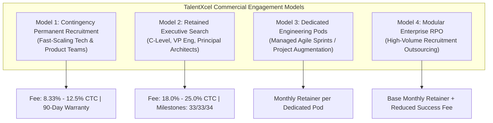
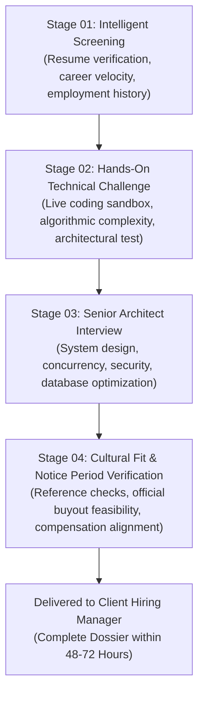

# IT STAFFING & TALENT ACQUISITION GO-TO-MARKET (GTM) STRATEGY

**Entity:** TalentXcel Services Private Limited (CIN: U85500UP2024PTC206390)  
**Corporate Headquarters:** Office 1917, 19th Floor, E-Square Building, Sector 96, Noida, UP 201301  
**Target Revenue Engine:** Pillar 02 — Staffing & Workforce Solutions  
**URL Architecture:** https://talentxcel.co.in/staffing-solutions  
**Publication Date:** November 2026  
**Author:** Chief Growth Officer & Enterprise Staffing Practice Lead  

---

## 1. Executive Summary & Market Economics

The tech staffing sector in India is valued at over $8 Billion, with specialized IT staffing growing at an annual rate exceeding 14%. However, the traditional recruitment agency model is plagued by inefficiency:
- **Low Hit-Rates:** Recruiters blindly forward hundreds of unfiltered LinkedIn resumes, overwhelming client hiring managers.
- **Prolonged Notice Periods:** 60 to 90-day notice periods in India lead to drop-out rates exceeding 40% between offer acceptance and joining.
- **Contract Cash Flow Hazards:** Under-capitalized staffing agencies entering contract staffing face severe working capital deficits due to delayed 60–90 day client invoicing against monthly payroll statutory mandates (PF/ESIC/GST).

**TalentXcel's Commercial Approach:**  
TalentXcel focuses primarily on **High-Margin Permanent Recruitment & Executive Search**, paired with **Selective Risk-Controlled Contract Staffing** and **Agile Pod Deployments**. We differentiate on technical rigor, delivering pre-screened shortlists evaluated by active software architects within 48 to 72 hours, backed by an industry-leading **90-Day Free Replacement Guarantee**.

---

## 2. Commercial Engagement Models & Rate Architecture

### Model 1: Permanent Contingency Recruitment
- **Best Suited For:** Mid-level to senior software engineers, frontend/backend leads, data engineers, QA leads, and product managers.
- **Commercial Fee Structure:**
  - Standard Requisition (Junior to Mid-Level, CTC up to INR 15 LPA): **8.33% of Annual CTC** (equivalent to 1 month's gross compensation).
  - Senior Specialists & Tech Leads (CTC INR 15 LPA to INR 35 LPA): **10.0% to 12.5% of Annual CTC**.
  - Highly Niche Requisitions (AI/ML Engineers, Blockchain, Rust, Staff Engineers, CTC > 35 LPA): **12.5% to 15.0% of Annual CTC**.
- **Payment Terms:** Net-30 days from candidate start date.
- **Warranty:** 90-Day Free Replacement. If candidate leaves or is terminated for cause within 90 days, TalentXcel provides an equivalent replacement at zero additional charge.

### Model 2: Retained Executive Search
- **Best Suited For:** C-Suite (CTO, CIO, CPO, CHRO), Vice Presidents of Engineering, and Board-level appointments.
- **Commercial Fee Structure:** **18.0% to 22.0% of Total First-Year Guaranteed Compensation**.
- **Retainer Schedule:**
  - 33% upfront retainer upon mandate sign-off and market mapping launch.
  - 33% upon delivery and interview sign-off of validated executive shortlist (within 21 days).
  - 34% upon executive contract signing and formal offer acceptance.
- **Warranty:** 180-Day Free Executive Replacement guarantee.

### Model 3: Dedicated Managed Engineering Pods
- **Best Suited For:** Product companies requiring an immediate, turn-key engineering squad (e.g., 1 Tech Lead, 2 Full-Stack Engineers, 1 QA Automation Engineer).
- **Commercial Model:** Fixed Monthly Managed Service Billing (INR 4.5L – INR 8.5L per pod/month depending on seniority).
- **Benefits:** No permanent payroll overhead for client; flexible 3-month rolling renewal; zero statutory recruitment friction.

### Model 4: Modular Enterprise RPO (Recruitment Process Outsourcing)
- **Best Suited For:** Enterprises undergoing rapid headcount expansion (hiring 20+ roles per quarter).
- **Commercial Structure:** Fixed monthly platform/recruiter retainer (INR 1,20,000/month/recruiter) + reduced placement success fee (4.0% to 5.0% of CTC).

---

## 3. Financial & Operational Risk Analysis: Contract Staffing

Contract staffing carries severe cash flow and legal liability in India. TalentXcel applies strict financial governance criteria before accepting contract staffing mandates:

| Risk Dimension | Inherent Market Hazard | TalentXcel Risk-Control Policy |
| :--- | :--- | :--- |
| **Working Capital Float** | Clients often demand 60–90 day payment cycles, but employee salaries, PF (12%), ESIC, and GST (18%) must be deposited monthly. | **Strict Credit Filter:** Contract staffing accepted *only* with enterprise clients passing Dun & Bradstreet / credit checks with agreed Net-30 payment terms, or requiring a 1-month rolling payroll advance deposit. |
| **Co-Employment Liability** | Contract employees claiming permanent status or non-compliance benefits against principal employer. | **Complete Statutory Indemnity:** TalentXcel operates as the sole employer of record (EOR) maintaining 100% PF/ESIC/Professional Tax compliance and issuing monthly statutory deposit challans. |
| **Bench & Attrition Cost** | Contract resources resigning mid-sprint leaving the vendor with unbilled overhead. | **Client Notice Parity:** Contract agreements mandate a 30-day client termination notice and a matching 30-day employee notice period, backed by back-to-back replacement pipelines. |

---

## 4. The 4-Stage Practitioner Vetting Framework

To eliminate candidate drop-offs and poor technical performance, TalentXcel enforces a rigorous 4-stage practitioner review before candidate presentation:

1. **Stage 01: Intelligent Screening & Credential Verification:** Verification of authentic work history, employment tenure consistency, notice period validity, and MCA/PF record consistency.
2. **Stage 02: Hands-On Technical Benchmark:** Candidates execute practical engineering exercises in real development environments (not theoretical multiple-choice quizzes).
3. **Stage 03: Senior Architect Video Interview:** A 45-minute technical evaluation conducted by an active principal engineer assessing real-world debugging, trade-off analysis, and system architecture.
4. **Stage 04: Notice Period & Offer Acceptance Audit:** Verification of resignation status, offer letters in hand, counter-offer likelihood, and salary expectation lock-in.

---

## 5. Enterprise Acquisition Playbook & Outreach Strategy

### 5.1 Requisition Intake SLA & Response Metrics
- **Initial Intake Call:** Conducted within 2 hours of mandate submission on `/staffing-solutions`.
- **Market Mapping & Shortlist Delivery:** First batch of 3–5 rigorously vetted candidate dossiers delivered within **48 to 72 hours**.
- **Interview Coordination:** Handled completely by TalentXcel operations to guarantee zero recruiter bottleneck.

### 5.2 High-Conversion Outreach Message to Enterprise Engineering Leads

> **Subject:** Senior React/Node & GenAI engineers available for [Company Name] in NCR  
> 
> Hi [First Name],  
> 
> Most tech recruiters send dozens of keyword-matched resumes that haven't written a single unit test.  
> 
> At **TalentXcel** (Noida Sector 96), we operate differently: every engineer presented to your team is vetted in a live code review by our practicing technical architects before you ever see their CV.  
> 
> We currently have an active bench of vetted software engineers in the Delhi-NCR / Bengaluru corridors across:  
> - Full-Stack React & Node.js (immediate joiners to 15-day notice)  
> - Applied GenAI & Python ML Engineers  
> - Cloud-Native DevOps (Docker / K8s / AWS)  
> 
> We operate on a standard **contingency model with an ironclad 90-day free replacement guarantee**. You only pay when you make a successful hire.  
> 
> Would you be open to reviewing two anonymized engineering dossiers matching your current open roles?  
> 
> Sincerely,  
> **Enterprise Staffing Practice**  
> TalentXcel Services Private Limited  
> Office 1917, E-Square Building, Sector 96, Noida | +91 98711 70000 | https://talentxcel.co.in/staffing-solutions  

---

## 6. Staffing Revenue Targets & Growth Trajectory

- **Average Permanent Placement Fee:** INR 1,80,000 (based on an average mid-level CTC of INR 18 LPA @ 10% fee).
- **Target Closures (Month 1–3):** 5 placements per month = **INR 9,00,000 / month**.
- **Target Closures (Month 4–12):** 12–15 placements per month + 2 Executive Search mandates = **INR 25,00,000 to INR 35,00,000 / month**.
- **Year 1 Target Staffing Revenue:** **INR 2.4 Crore to INR 3.0 Crore**.
