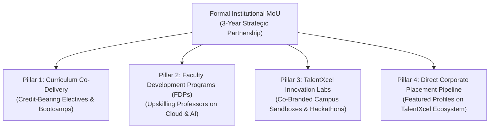

# UNIVERSITY & INSTITUTIONAL PARTNERSHIPS STRATEGY (MoU FRAMEWORK)

**Entity:** TalentXcel Services Private Limited (CIN: U85500UP2024PTC206390)  
**Corporate Office:** Office 1917, 19th Floor, E-Square Building, Sector 96, Noida, UP 201301  
**Target Revenue Engine:** Pillar 03 — Learning & Talent Development (Institutional Sector)  
**URL Architecture:** https://talentxcel.co.in/university-partnerships  
**Publication Date:** November 2026  
**Author:** Chief Growth Officer & Head of Academic Collaborations  

---

## 1. Executive Context & Institutional Need

Higher education institutions across India (particularly NAAC/NBA-accredited engineering colleges and private universities in Uttar Pradesh, Haryana, Punjab, Rajasthan, and the wider North India belt) face an acute structural challenge:
1. **Curriculum Latency:** University curricula take 2 to 3 years to update, leaving graduating cohorts unexposed to modern cloud-native architectures, containerization, and Generative AI workflows.
2. **Placement Metric Pressures:** NIRF rankings and NAAC accreditations heavily penalize institutions with low median salary packages or poor campus placement conversion ratios.
3. **The Industry-Academia Gap:** Corporates visiting campus drives complain that over 60% of graduating computer science students cannot write modular code or debug live applications.

**The TalentXcel Opportunity:**  
TalentXcel positions itself as the **Industry Co-Development & Employability Partner** for academic institutions. We bridge the gap through formal institutional MoUs, deploying practitioner-led semester tracks, AI student academies, faculty development programs (FDPs), and a direct hiring pipeline powered by our corporate client network and the `talentxcel.in` candidate platform.

---

## 2. Institutional MoU Structure & Operating Framework

The TalentXcel Institutional Partnership Agreement is structured as a 3-Year Strategic Memorandum of Understanding (MoU) with annual performance milestones:
- **Joint Steering Committee:** Bi-annual review between the University Vice-Chancellor / Dean of Academics and TalentXcel Practice Directors.
- **Credit Integration:** Modular courses structured to align with AICTE / UGC elective credit requirements (2 to 4 credits per semester).
- **Practical Lab Hours:** Mandatory 70:30 practical-to-theory ratio, with code commits evaluated on GitHub/GitLab.

---

## 3. Campus Employability Finishing School Curriculum

### Track A: Full-Stack Enterprise Software Engineering (6th/7th Semester)
- **Target:** Computer Science, Information Technology, and MCA students.
- **Duration:** 60 Hours (Spread over 12 weeks).
- **Core Syllabus:**
  - Modern JavaScript/TypeScript, React fundamentals, component design patterns.
  - Server-side REST APIs with Node.js/Express, relational database design with PostgreSQL.
  - Git collaboration, branching models, unit testing with Jest, Docker fundamentals.
  - Capstone: End-to-end full-stack SaaS platform deployed live on public cloud infrastructure.

### Track B: Applied Artificial Intelligence & Generative AI (7th/8th Semester)
- **Target:** 3rd/4th Year Engineering students seeking high-value product development roles.
- **Duration:** 45 Hours (Spread over 8 weeks).
- **Core Syllabus:**
  - Python for AI, data manipulation with Pandas/NumPy, vector math fundamentals.
  - Understanding Transformers, working with open-source LLMs (Hugging Face, Ollama).
  - Building Retrieval-Augmented Generation (RAG) applications with LangChain / LlamaIndex.
  - Capstone: Domain-specific AI assistant with vector database retrieval and structured JSON output.

### Track C: Cloud Infrastructure & DevOps Fundamentals
- **Target:** Engineering students pursuing cloud architect and systems engineering roles.
- **Duration:** 40 Hours (Spread over 8 weeks).
- **Core Syllabus:**
  - Linux systems administration, bash scripting, network fundamentals.
  - AWS/GCP core services (Compute, Storage, VPC, IAM).
  - Continuous Integration & Deployment (CI/CD) pipelines with GitHub Actions.
  - Capstone: Automated zero-downtime deployment pipeline for microservice applications.

---

## 4. Co-Branded Campus Innovation Labs & Hackathons

To establish deep brand presence on campus, TalentXcel partners with universities to launch:
1. **The TalentXcel AI Center of Excellence (CoE):** A designated laboratory equipped for high-performance computing, where selected high-aptitude students work on live industry micro-projects mentored by TalentXcel software architects.
2. **Annual Regional Hackathons:** 36-hour hackathons co-hosted on campus, judged by corporate enterprise CTOs, offering cash awards, direct internship offers, and cloud credits.
3. **Pre-Placement Talk (PPT) Series:** Regular masterclasses by industry leaders on interview readiness, algorithmic problem-solving, and resume optimization.

---

## 5. Commercial Pricing & Revenue Models

TalentXcel offers institutions three flexible commercial engagement structures to accommodate varying fee frameworks and socio-economic demographics:

| Commercial Model | Structure & Cost Basis | Typical Pricing | Target Institution Category |
| :--- | :--- | :--- | :--- |
| **Model A: Institutional Bulk License** | College pays an all-inclusive institutional subscription per academic year for an entire batch (e.g., 200–500 students). | **INR 5,00,000 – INR 12,00,000** per institution / year | Autonomous engineering colleges, NAAC A+ universities, private multi-disciplinary universities. |
| **Model B: Student Co-Pay / Value-Add Fee** | Low-cost modular course fee integrated into semester elective fees or paid directly by participating students. | **INR 2,500 – INR 4,500** per student (minimum batch size: 100 students) | Affiliated engineering colleges with fee regulation constraints. |
| **Model C: Corporate CSR Sponsored Model** | Program subsidized or fully funded through corporate CSR partnerships focused on youth employability and women in tech. | **Zero cost to institution** (funded by enterprise CSR grants) | Tier-2/Tier-3 government colleges, rural institutions, economically underserved student populations. |

---

## 6. Corporate Placement Integration & Ecosystem Pathway

The critical differentiator of TalentXcel's university program is the **guaranteed placement facilitation pathway**:
1. **Assessment & Profiling:** Students completing the finishing school undergo standardized technical assessment benchmarks.
2. **Platform Promotion:** Certified high-scoring candidates receive verified badges on `talentxcel.in` and are featured in curated candidate pools on `talentxcel.net`.
3. **Campus Placement Drives:** TalentXcel actively invites its 50+ corporate staffing and enterprise clients to participate in pooled campus placement drives, creating tangible hiring outcomes for the partner institution.

---

## 7. Institutional Outbound Strategy & Milestones

- **Initial Outreach:** Direct engagement with Vice-Chancellors, Principals, and Directors of Corporate Relations / Training & Placement (T&P).
- **Territory Focus:** Noida Knowledge Park, Greater Noida, Ghaziabad, Meerut, Gurugram, Jaipur, and Chandigarh education corridors.
- **Q1 Institutional Goal:** 3 Signed Institutional MoUs = **INR 15,00,000 to INR 25,00,000**.
- **Year 1 Target:** 15 Partner Universities, 3,500+ students trained = **INR 75,00,000+** in institutional revenue.
